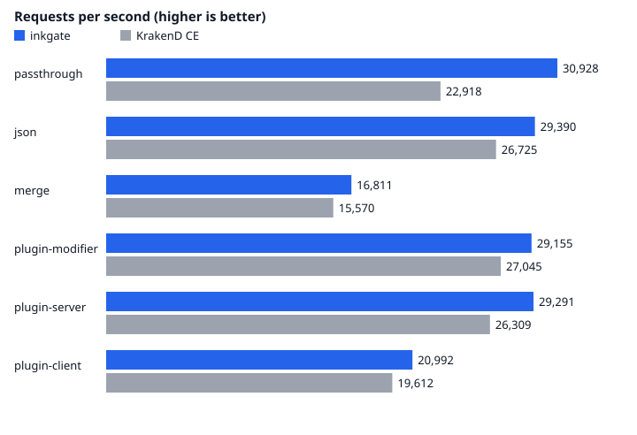

# inkgate

inkgate is an API gateway. It receives an HTTP request, applies security and traffic rules, calls one or more
backends, merges their answers and returns one response. This repository builds it on the
[gorilla/mux](https://github.com/gorilla/mux) router.

Inspired by [KrakenD](https://www.krakend.io) ([krakend-ce](https://github.com/krakend/krakend-ce)) and the
[Lura](https://luraproject.org) framework it is built on: inkgate keeps their configuration format and most of their
feature set, and adds what they leave out (Server-Sent Events and WebSocket proxying, a leaner request path). Their
copyright notices are kept in [NOTICE](NOTICE), as the Apache-2.0 license requires.

## Get it

```sh
git clone https://github.com/9edang/inkgate.git
cd inkgate
go install github.com/9edang/inkgate/cmd/inkgate@latest    # or build it here, below
```

## Quick start

```sh
make build                              # bin/inkgate (VERSION=0.1.0 by default)
bin/inkgate check -c inkgate.json       # validate a config
bin/inkgate run -c inkgate.json -d      # run (-d enables /__debug and debug logs)
bin/inkgate --help                      # run, check, check-plugin, audit, test-plugin, version
```

Flexible config (templates) is enabled with `FC_ENABLE=1` and `FC_SETTINGS`, `FC_PARTIALS`, `FC_TEMPLATES`,
`FC_OUT`.

## Layout

```
inkgate/
├── cmd/inkgate/     the binary: boot.Main(entry.Router)
├── context/         the flow context: core data of one request, carried by every layer (replaces "context")
├── flow/            WHEN things happen: boot → entry → request → endpoint → backend
├── feature/         WHAT the gateway can do; router code sits next to its feature
├── engine/          the plumbing: config, proxy pipeline, HTTP transport, discovery, CLI; the router in engine/router
├── internal/        helper libraries
├── examples/        small runnable programs (the Lua binder examples)
├── schema/          the JSON schema of inkgate.json, embedded for `check --lint-no-network`
├── docs/            documentation, and the milestones (what to fix, speed up and add next)
└── tests/           integration suite, run against bin/inkgate
```

Start reading at [docs/README.md](docs/README.md). What comes next is in [docs/milestones](docs/milestones/README.md).

## Benchmark

<!-- benchmark:start -->
inkgate against KrakenD CE `2.13.11`, in containers with the same config and the same limits (2 CPUs and 512m memory each, 128 connections, 30s per run, median of 3 rounds), on AMD Ryzen 5 5600 6-Core Processor.

| Scenario | inkgate req/s | KrakenD CE req/s | inkgate p99 | KrakenD CE p99 | inkgate memory | KrakenD CE memory |
|---|--:|--:|--:|--:|--:|--:|
| passthrough | **32,607** (1.40x) | 23,354 | 10.1 ms | 12.8 ms | 39 MB | 40 MB |
| json | **30,191** (1.10x) | 27,331 | 10.9 ms | 11.8 ms | 39 MB | 41 MB |
| merge | **17,175** (1.08x) | 15,900 | 15.4 ms | 16.5 ms | 45 MB | 44 MB |
| plugin-modifier | **30,371** (1.09x) | 27,953 | 11.3 ms | 11.7 ms | 48 MB | 46 MB |
| plugin-server | **30,044** (1.12x) | 26,891 | 11.3 ms | 12.0 ms | 48 MB | 44 MB |
| plugin-client | **20,926** (1.04x) | 20,034 | 14.2 ms | 15.1 ms | 44 MB | 45 MB |



Setup, scenarios and how to rerun it: [benchmark/](benchmark/README.md). Full report: [benchmark/results/report.md](benchmark/results/report.md).
<!-- benchmark:end -->

## Tests

```sh
make test          # build, unit tests and the integration suite
```

Known unit-test failures and their causes: [docs/known-issues.md](docs/known-issues.md).

## License

Apache-2.0, Copyright 2026 9edang. See [LICENSE](LICENSE) and [NOTICE](NOTICE). The code derives from KrakenD and Lura,
also Apache-2.0; their attribution notices are reproduced in NOTICE and must stay with any copy or fork.
