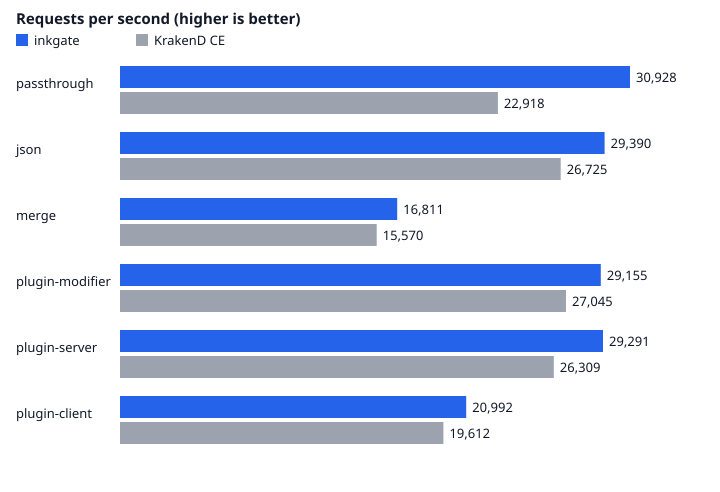

# inkgate vs KrakenD CE

Run on 2026-11-11T22:08:22Z. The median of 3 rounds is shown, picked by requests per second.

## Setup

| | |
|---|---|
| Host | AMD Ryzen 5 5600 6-Core Processor, 12 threads, 8 GB RAM, Linux 7.3.3-300.fc45.x86_64 |
| inkgate | `localhost/inkgate-bench:dev` (built from this repository), revision `6e90ab3`, Go 1.27.4, glibc 2.41 |
| KrakenD CE | `docker.io/library/krakend:2.13.11` |
| Backend | `docker.io/library/nginx:1.31.8-alpine`, fixed JSON answers, 2 CPUs |
| Load generator | `ghcr.io/hatoo/oha:1.16.0`, 128 keep-alive connections, 4 CPUs |
| Each gateway | 2 CPUs, 512m memory, one at a time |
| Per run | 10s warm-up, then 30s measured |
| Config | the same file for both: [config/gateway.json](../config/gateway.json) |

## Results

### passthrough: one backend, no-op encoding (the body is streamed, never parsed)

| Gateway | Requests/s | Avg | p50 | p90 | p99 | Success | CPU (of 100% per CPU) | Peak memory |
|---|--:|--:|--:|--:|--:|--:|--:|--:|
| inkgate | 32,607 | 3.92 ms | 3.51 ms | 6.97 ms | 10.06 ms | 100.00% | 169% | 39 MB |
| KrakenD CE | 23,354 | 5.48 ms | 5.16 ms | 9.54 ms | 12.84 ms | 100.00% | 173% | 40 MB |

inkgate serves **1.40x** the requests per second of KrakenD CE here. Runs (req/s): inkgate [27465, 32772, 32607], KrakenD [19749, 23354, 23369].

### json: one backend, JSON is decoded and encoded again

| Gateway | Requests/s | Avg | p50 | p90 | p99 | Success | CPU (of 100% per CPU) | Peak memory |
|---|--:|--:|--:|--:|--:|--:|--:|--:|
| inkgate | 30,191 | 4.24 ms | 3.80 ms | 7.54 ms | 10.88 ms | 100.00% | 169% | 39 MB |
| KrakenD CE | 27,331 | 4.68 ms | 4.26 ms | 8.24 ms | 11.84 ms | 100.00% | 171% | 41 MB |

inkgate serves **1.10x** the requests per second of KrakenD CE here. Runs (req/s): inkgate [26377, 30191, 30671], KrakenD [23189, 27331, 27376].

### merge: two backends called in parallel, both JSON bodies merged into one

| Gateway | Requests/s | Avg | p50 | p90 | p99 | Success | CPU (of 100% per CPU) | Peak memory |
|---|--:|--:|--:|--:|--:|--:|--:|--:|
| inkgate | 17,175 | 7.45 ms | 7.00 ms | 11.71 ms | 15.36 ms | 100.00% | 173% | 45 MB |
| KrakenD CE | 15,900 | 8.05 ms | 7.69 ms | 12.46 ms | 16.50 ms | 100.00% | 174% | 44 MB |

inkgate serves **1.08x** the requests per second of KrakenD CE here. Runs (req/s): inkgate [14525, 17175, 17342], KrakenD [14878, 15900, 15970].

### plugin-modifier: one backend, a request modifier plugin adds a header and a response modifier plugin adds a field

| Gateway | Requests/s | Avg | p50 | p90 | p99 | Success | CPU (of 100% per CPU) | Peak memory |
|---|--:|--:|--:|--:|--:|--:|--:|--:|
| inkgate | 30,371 | 4.21 ms | 3.74 ms | 7.55 ms | 11.26 ms | 100.00% | 170% | 48 MB |
| KrakenD CE | 27,953 | 4.58 ms | 4.15 ms | 8.08 ms | 11.66 ms | 100.00% | 171% | 46 MB |

inkgate serves **1.09x** the requests per second of KrakenD CE here. Runs (req/s): inkgate [30371, 30262, 30450], KrakenD [27178, 27953, 28147].

### plugin-server: one backend, a server plugin wraps the HTTP handler and adds a response header

| Gateway | Requests/s | Avg | p50 | p90 | p99 | Success | CPU (of 100% per CPU) | Peak memory |
|---|--:|--:|--:|--:|--:|--:|--:|--:|
| inkgate | 30,044 | 4.26 ms | 3.79 ms | 7.62 ms | 11.32 ms | 100.00% | 170% | 48 MB |
| KrakenD CE | 26,891 | 4.76 ms | 4.32 ms | 8.38 ms | 11.95 ms | 100.00% | 171% | 44 MB |

inkgate serves **1.12x** the requests per second of KrakenD CE here. Runs (req/s): inkgate [30034, 30044, 30291], KrakenD [27028, 26891, 26681].

### plugin-client: one backend, a client plugin replaces the backend client and calls the API itself

| Gateway | Requests/s | Avg | p50 | p90 | p99 | Success | CPU (of 100% per CPU) | Peak memory |
|---|--:|--:|--:|--:|--:|--:|--:|--:|
| inkgate | 20,926 | 6.11 ms | 5.73 ms | 10.75 ms | 14.20 ms | 100.00% | 175% | 44 MB |
| KrakenD CE | 20,034 | 6.39 ms | 5.99 ms | 11.18 ms | 15.13 ms | 100.00% | 176% | 45 MB |

inkgate serves **1.04x** the requests per second of KrakenD CE here. Runs (req/s): inkgate [21145, 20926, 20839], KrakenD [20018, 20034, 20098].

## Plugin cost

Requests per second of each plugin scenario as a share of the same gateway on `json` (one backend, no plugin). The plugin source is the same for both gateways; it is built once with each toolchain.

| Scenario | inkgate | KrakenD CE |
|---|--:|--:|
| plugin-modifier | 101% | 102% |
| plugin-server | 100% | 98% |
| plugin-client | 69% | 73% |



## Reproduce

```sh
cd benchmark
./run.sh                       # builds the inkgate image, runs everything, rewrites results/
DURATION=60s ROUNDS=5 ./run.sh  # longer, more rounds
```

Numbers depend on the machine; compare the two gateways within one run, not across machines.
