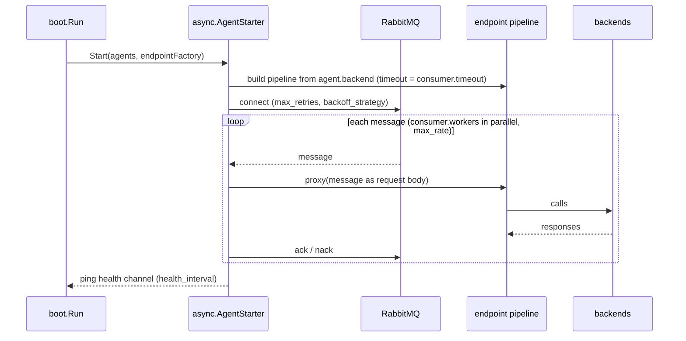

# engine/async, engine/plugin and engine/register

## Async agents — work that starts from a queue, not from HTTP

**Code:** [engine/async](../../engine/async), driver in [feature/connector/amqp/async](../../feature/connector/amqp/async)

An async agent consumes messages from a queue and pushes each one through a normal endpoint pipeline (stages 4 and 5).
No HTTP request is involved.



Config: top-level `async_agent[]` with `name`, `consumer{topic, workers, timeout, max_rate}`,
`connection{max_retries, backoff_strategy, health_interval}`, `backend[]` and `extra_config` holding
`async/amqp` (`host`, `name`, `exchange`, `durable`, `delete`, `exclusive`, `no_wait`, `prefetch_count`,
`prefetch_size`, `auto_ack`, `no_local`, `nack_discard`).

## Go plugins — custom code without forking

**Code:** [engine/plugin](../../engine/plugin), loaders in `engine/transport/http/{server,client}/plugin` and
`engine/proxy/plugin`, wiring in `flow/boot/plugins.go`

| Plugin type | Config alias | Where it runs | Interface |
|---|---|---|---|
| http-server | `plugin/http-server` (service) | stage 2, wraps the whole HTTP handler | exported symbol `HandlerRegisterer` with `RegisterHandlers(...)` |
| http-client | `plugin/http-client` (backend) | stage 5, replaces the HTTP client call | exported symbol `ClientRegisterer` with `RegisterClients(...)` |
| req/resp modifier | `plugin/req-resp-modifier` (endpoint or backend) | stage 4 and the backend stack | exported symbol `ModifierRegisterer` with `RegisterModifiers(...)` |

### Several http-client plugins on one backend

`name` can be a list. The plugins are chained in list order, the first one runs first, and each one wraps the next.
The regular backend HTTP call closes the chain.

```json
"extra_config": {
  "plugin/http-client": {
    "name": ["client-example-one", "client-example-two"],
    "client-example-one": { "path": "/some-path" },
    "client-example-two": { "path": "/some-path" }
  }
}
```

Every plugin gets the whole `plugin/http-client` object and reads its own settings from the key named like itself.
A chainable plugin is written like a middleware: its `RegisterClients(f)` registers
`func(ctx, extra, next http.Handler) (http.Handler, error)` and calls `next.ServeHTTP` to continue the chain
(the last `next` is the regular backend call). The method name is unchanged; the gateway tells the two forms
apart by the handler signature. A plugin written with the old `func(ctx, extra) (http.Handler, error)` still
loads and works: it replaces the backend call and cannot continue the chain, so the plugins listed after it are
skipped (logged as a warning). A single string `name` keeps working as before. A name that is not registered is
skipped; if no name is usable the normal HTTP client is used.

All three may also implement `RegisterLogger(any)`. Modifiers may implement `RegisterContext(ctx)`.

Plugins are `.so` files built with `go build -buildmode=plugin`. They are loaded at boot from
`plugin.folder` and `plugin.pattern`. They must be built with the **same Go version and the same dependency
versions** as inkgate: `check-plugin` compares a plugin's `go.sum`, and `test-plugin` tries to load it.

## Register

**Code:** [engine/register](../../engine/register)

A small name → value store used by `sd` (subscriber factories), `encoding` and `proxy` combiners, so features can
register implementations by name at boot.
