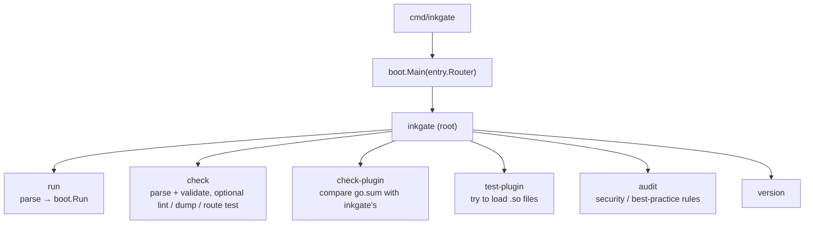

# engine/cli — the command line

**Code:** [engine/cli](../../engine/cli), assembled in [flow/boot/main.go](../../flow/boot/main.go). The binary is `inkgate`.

| Command | Flags | Purpose |
|---|---|---|
| `run` | `-c` config, `-d` debug endpoint, `-p` port | start the gateway |
| `check` | `-c`, `-d` (repeat for more detail), `-i` indent, `-t` test routes, `-l` lint against `INKGATE_SCHEMA_URL`, `-s` custom schema path/URL, `-n` lint with the built-in schema | validate a config without starting |
| `check-plugin` | `-s` go.sum, `-g` Go version, `-l` libc, `-f` show fix commands | check plugin dependency compatibility |
| `test-plugin` | `-s` server, `-c` client, `-m` modifier, then `.so` paths | load plugins and report errors |
| `audit` | `-c`, `-i` ignore rules, `-I` ignore file, `-s` severities, `-f` Go template | find risky settings (`feature/telemetry/audit`) |
| `version` | | inkgate, Go and glibc versions |

## Hooks filled by `entry.Router`

| Variable | Set by | Used by |
|---|---|---|
| `cli.RunRouterFunc` | `boot.Main` from `Router.TestRoutes` | `check -t`: registers every endpoint on the real router for one second, so route conflicts fail the check |
| `cli.DefaultRoot.Cmd.Use` | `boot.Main` | the binary name in help (`inkgate`) |

## Environment

| Variable | Effect |
|---|---|
| `INKGATE_SCHEMA_URL` | JSON schema used by `check -l`. Without it, `-l` fails and tells you to use `-s` |
| `FC_ENABLE`, `FC_SETTINGS`, `FC_PARTIALS`, `FC_TEMPLATES`, `FC_OUT` | flexible config (see [config.md](config.md)) |
| `INKGATE_USAGE_URL` | enables the anonymous usage reporter (off when unset) |

`flow/boot/main.go` also registers the short namespace aliases (`aliases` map) and embeds
`flow/boot/schema/schema.json` for `check -n`. That file is a placeholder (`{}`) until a schema is written.
