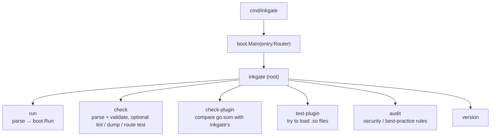

# engine/cli — the command line

**Code:** [engine/cli](../../engine/cli), assembled in [flow/boot/main.go](../../flow/boot/main.go). The binary is `inkgate`.

| Command | Flags | Purpose |
|---|---|---|
| `run` | `-c` config, `-d` debug endpoint, `-p` port, `--allow-unknown-namespaces` | start the gateway; refuses a config that [`check`](#what-run-and-check-refuse) would refuse |
| `check` | `-c`, `-d` (repeat for more detail), `-i` indent, `-t` test routes, `-l` lint against `INKGATE_SCHEMA_URL`, `-s` custom schema path/URL, `-n` lint with the built-in schema, `--allow-unknown-namespaces` | validate a config without starting |
| `check-plugin` | `-s` go.sum, `-g` Go version, `-l` libc, `-f` show fix commands | check plugin dependency compatibility |
| `test-plugin` | `-s` server, `-c` client, `-m` modifier, then `.so` paths | load plugins and report errors |
| `audit` | `-c`, `-i` ignore rules, `-I` ignore file, `-s` severities, `-f` Go template | find risky settings (`feature/telemetry/audit`) |
| `version` | | inkgate, Go and glibc versions |

## Hooks filled by `entry.Router`

| Variable | Set by | Used by |
|---|---|---|
| `cli.RunRouterFunc` | `boot.Main` from `Router.TestRoutes` | `check -t`: registers every endpoint on the real router for one second, so route conflicts fail the check |
| `cli.DefaultRoot.Cmd.Use` | `boot.Main` | the binary name in help (`inkgate`) |
| `cli.KnownNamespaces` | `boot.Main` from `boot.KnownNamespaces()` | `run` and `check`: the `extra_config` namespaces this build reads. Empty means no namespace check |
| `cli.CustomValidationFunc` | `boot.Main` | `run` and `check`: what the router would only find out when it builds an endpoint, today the `router/stream` options |

## Environment

| Variable | Effect |
|---|---|
| `INKGATE_SCHEMA_URL` | JSON schema used by `check -l`. Without it, `-l` fails and tells you to use `-s` |
| `FC_ENABLE`, `FC_SETTINGS`, `FC_PARTIALS`, `FC_TEMPLATES`, `FC_OUT` | flexible config (see [config.md](config.md)) |

`flow/boot/main.go` also registers the short namespace aliases (`aliases` map) and embeds
`schema/schema.json` for `check -n`.

## What `run` and `check` refuse

A key the gateway does not read is not an error to the parser: the feature behind it is simply off. So both commands
check the config after parsing it, and exit with status 1 and a message that names where the problem is:

- **An unknown `extra_config` namespace**, at the service, endpoint, backend or async agent level, with the closest
  known name: `endpoint GET /users: unknown extra_config namespace "qos/ratelimt/router" (did you mean
  "qos/ratelimit/router"?)`. The known names are the aliases of `flow/boot/main.go` (short and full) and the ones
  without alias; `flow/boot/namespaces_test.go` fails when a namespace is added to the code and not to that list.
  `--allow-unknown-namespaces` turns the check off, for a config migrated from KrakenD that carries namespaces inkgate
  does not read; they stay ignored.
- **A `router/stream` section** that is not an object, has an option that does not exist, or a bad value (see
  [router.md](router.md#streaming-server-sent-events-and-websocket)). `check` used to find this only with `-t`, and
  `run` only when it built the endpoint.

`check -n` goes further, with `schema/schema.json`: it also refuses an unknown key at the top level, in an endpoint
or in a backend, an unknown option inside any namespace, a namespace at a level that does not read it, a wrong type
(`"timeout": 3000` instead of `"3s"`), a bad duration and a bad enum value. It needs no network. Use it in the
pre-deploy check. `check -l` lints the same way against `INKGATE_SCHEMA_URL`, which can point at that file.

What neither sees: a valid namespace with an option the schema allows but the feature does not need, and anything
decided at runtime (a host that does not answer, a JWK URL that does not serve keys).
