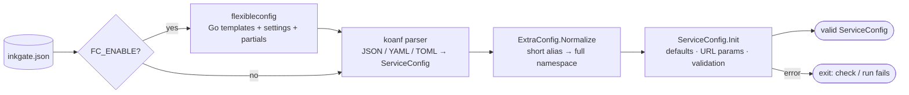

# engine/config — the configuration model

**Code:** [engine/config](../../engine/config) (+ `flexibleconfig/`, `koanf/`)

Everything inkgate does is driven by one JSON file. This package defines its shape, parses it, fills in defaults and
validates it before anything starts.



## The model

```mermaid
classDiagram
    class ServiceConfig {
      name, version (must be 3)
      host[], port, listen_ip
      timeout, cache_ttl, output_encoding
      tls, client_tls, use_h2c
      read/write/idle timeouts, dialer, idle connections
      plugin, debug_endpoint, echo_endpoint
      sequential_start, dns_cache_ttl
      extra_config
    }
    class EndpointConfig {
      endpoint, method
      timeout, cache_ttl, concurrent_calls
      input_headers[], input_query_strings[]
      output_encoding
      extra_config
    }
    class Backend {
      host[], url_pattern, method
      encoding, sd (static|dns), sd_scheme
      allow[], deny[], mapping, group, target
      is_collection, disable_host_sanitize
      input_headers[], input_query_strings[]
      extra_config
    }
    class AsyncAgent {
      name, consumer{topic, workers, timeout, max_rate}
      connection{max_retries, backoff_strategy, health_interval}
      encoding, extra_config
    }
    ServiceConfig "1" --> "*" EndpointConfig : endpoints
    ServiceConfig "1" --> "*" AsyncAgent : async_agent
    EndpointConfig "1" --> "1..*" Backend : backend
    AsyncAgent "1" --> "1..*" Backend : backend
```

`extra_config` is a `map[string]any` keyed by **namespace**. Each feature reads only its own key, so features don't
know about each other. Namespaces and aliases are listed in [../guides/config-reference.md](../guides/config-reference.md).

## What `Init` does

| Step | Function | Effect |
|---|---|---|
| global | `initGlobalParams` | default `timeout` (2 s), `cache_ttl`, port 8080, output encoding, validates `listen_ip` |
| agents | `initAsyncAgents` | defaults for each async agent and its backends |
| endpoints | `initEndpoints` | per endpoint: defaults from the service, validates path and method, rejects duplicate endpoint+method, endpoints without backends, and `no-op` endpoints with more than one backend |
| backends | `initBackendDefaults` | inherits host, timeout and encoding; normalizes method |
| URL params | `initBackendURLMappings` | every `{param}` in `url_pattern` must exist in the endpoint path, or come from a previous backend in sequential mode |

Errors are typed (`EndpointMatchError`, `NoBackendsError`, `UnsupportedVersionError`, `EndpointPathError`,
`UndefinedOutputParamError`, `WrongNumberOfParamsError`), so `check` can explain what's wrong.

## Flexible config

With `FC_ENABLE=1` the file is a Go template, rendered before parsing:

| Env var | Meaning |
|---|---|
| `FC_SETTINGS` | folder of JSON files; each becomes `.<filename>` in templates |
| `FC_PARTIALS` | folder of raw text files, included with `{{ include "file" }}` |
| `FC_TEMPLATES` | folder of sub-templates, used with `{{ template "name" . }}` |
| `FC_OUT` | write the rendered config to this file (debugging) |

`flow/boot/main.go` wires this up.
