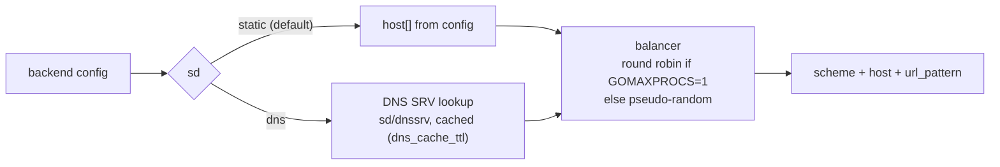

# engine/encoding and engine/sd

## Encoding — reading backend bodies

**Code:** [engine/encoding](../../engine/encoding) (+ XML/RSS from `feature/transform`, registered at boot)

The backend `encoding` decides how a response body becomes `Response.Data`:

| Value | Decoder | Result |
|---|---|---|
| `json` (default) | `encoding/json` | object → map; array → `{"collection": [...]}` when `is_collection` |
| `safejson` | JSON, any shape | object → map; array → `{"collection": [...]}`; scalar → `{"content": v}` |
| `xml` | `feature/transform/xml` | XML → map |
| `rss` | `feature/transform/rss` | RSS/Atom feed → map |
| `string` | raw text | `{"content": "<body>"}` |
| `no-op` | none | body streamed as-is in `Response.Io`; no merge, no manipulation |

The **output** side (what the client receives) is the endpoint `output_encoding`, rendered by the router: `engine/router/render.go` (+ `negotiate.go`).

## Service discovery — finding backend hosts

**Code:** [engine/sd](../../engine/sd)

- `sd_scheme` sets the scheme for DNS-discovered hosts (`http` by default).
- `disable_host_sanitize` keeps the host string untouched (for example for non-HTTP connectors).
- Subscribers are registered by name in `sd.GetRegister()`. Boot registers `dns`.
