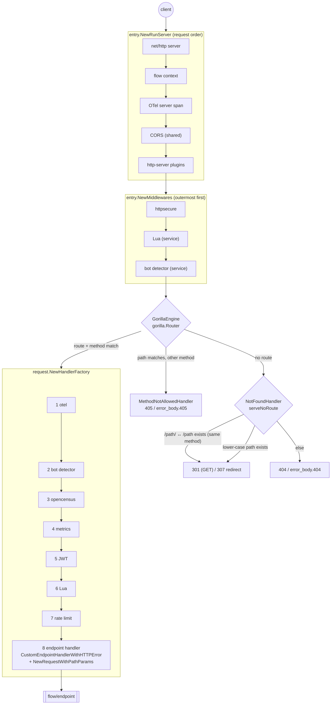

# inkgate

The inkgate gateway on the [gorilla/mux](https://github.com/gorilla/mux) router.

```sh
make build                                 # → bin/inkgate
bin/inkgate run -c inkgate.json        # serve
bin/inkgate check -t -c inkgate.json   # validate + register routes on a real gorilla router
```

## Folder

```
inkgate/
├── cmd/inkgate/main.go        sets config.RoutingPattern = brackets, then boot.Main(entry.Router)
├── flow/
│   ├── entry/                     stage 2: listener + router
│   │   ├── serve.go               entry.Router (the boot.Router value) and Serve
│   │   ├── engine.go              NewMiddlewares: service-wide middleware, in request order
│   │   └── server.go              NewRunServer: server → flow context → OTel → CORS → plugins
│   └── request/request.go         stage 3: per-endpoint handler steps
├── engine/
│   └── router/mux/                the gorilla/mux router
│       ├── router.go              NewFactory, Run: registers debug/echo/health and the endpoints
│       ├── engine.go              GorillaEngine: gorilla router, one route per endpoint + method
│       ├── options.go             NewEngine: router options, 404/405, redirects, health with agents
│       ├── params.go              path params from gorilla Vars, WithParams, ClientIP
│       ├── endpoint.go            the endpoint handler (stage 3 step 8), error writing
│       ├── render.go, negotiate.go  output encodings, Accept negotiation, YAML
│       └── debug.go, echo.go
└── feature/                       router code, each next to its feature
    ├── auth/jose                  jose_router.go: JWT validator/signer middleware
    ├── security/{cors,httpsecure} cors_router.go, middleware.go
    ├── security/botdetector/gateway
    ├── telemetry/{metrics,opencensus,otel}
    ├── traffic/ratelimit/router
    └── transform/{lua/router,xml}
```

## Request path



## How it plugs into boot

`flow/entry/serve.go`:

| `boot.Router` field | implementation |
|---|---|
| `NewMetrics` | `feature/telemetry/metrics.NewHTTPMetrics`: collector + `/__stats` on its own small server (`listen_address`, default `:8090`) |
| `RegisterEncoders` | registers the `xml` render on the router |
| `TestRoutes` | runs `router.DefaultFactory` for one second; an invalid route template panics in `GorillaEngine.Handle`, which `check -t` reports |
| `Serve` | `router.NewFactory` with `NewEngine(cfg)`, `NewMiddlewares`, the health handler and `NewRunServer` |

## Routing details

| Topic | Behaviour |
|---|---|
| Path syntax | `cmd/inkgate` sets `config.RoutingPattern = BracketsRouterPatternBuilder`, so endpoints keep `{param}` and become gorilla route templates. Regexp variables work too: `/users/{id:[0-9]+}` |
| Path params | `PathParamExtractor` reads `mux.Vars(r)`; keys are Title-cased (`id` → `Id`) |
| Matching | gorilla matches the whole path, so `/users` and `/users/` are different routes |
| Methods | GET, POST, PUT, PATCH, DELETE; each endpoint is one gorilla route restricted with `.Methods(...)`. A known path with another method answers 405 |
| Invalid routes | `GorillaEngine.Handle` panics on a route error (for example a bad `{id:[}` regexp) instead of silently dropping it |
| Trailing slash | `/a/` ↔ `/a` redirect when the other form has a route for the same method (`disable_redirect_trailing_slash` turns it off) |
| Fixed path | `/StAtic` → `/static` redirect (`disable_redirect_fixed_path` turns it off) |
| Redirect code | 301 for GET, 307 for other methods |
| JWT params | the jose adapter puts claims used as `{{.JWT.<claim>}}` into the request context (`WithParams`); the param extractor merges them |
| Client IP | `X-Forwarded-For`, then `X-Real-Ip`, then `X-Appengine-Remote-Addr`, then the connection address (`ClientIP`); used by the `ip` rate-limit strategy |
| `param` rate-limit strategy | reads the gorilla variable named by `key` |

## Router options (`router` / `inkgate/engine/router`)

| Option | Supported |
|---|---|
| `return_error_msg`, `error_body`, `disable_health`, `health_path`, `disable_redirect_trailing_slash`, `disable_redirect_fixed_path` | yes (`engine/router/options.go`) |
| `trusted_proxies` | used by the shared OpenTelemetry server wrapper only |
| `disable_access_log`, `logger_skip_paths`, `auto_options`, `forwarded_by_client_ip`, `remote_ip_headers`, `app_engine`, `max_multipart_memory`, `remove_extra_slash`, `disable_path_decoding`, `disable_handle_method_not_allowed`, `hide_version_header` | no — ignored |

## Built-in endpoints

| Path | When | Answer |
|---|---|---|
| `/__health` (or `health_path`) | unless `disable_health` | `{"status":"ok","agents":{...},"now":"..."}` |
| `/__debug/{params:.*}` | `debug_endpoint: true` or `run -d` | logs and echoes the request |
| `/__echo/{params:.*}` | `echo_endpoint: true` | returns the request as JSON |
| `/__stats` on `:8090` | `telemetry/metrics` enabled | metrics snapshot |

## Output encodings

`json` (default), `json-collection`, `string`, `no-op`, `xml`, `yaml`, `negotiate`. Content types:
`application/json; charset=utf-8`, `application/xml`, `application/yaml; charset=utf-8`, `text/plain; charset=utf-8`.
`negotiate` picks JSON, XML or YAML from the `Accept` header (`negotiate.go`).

## Errors

- Pipeline errors: status only; with `return_error_msg: true` the error text is the body (`writeError` in `endpoint.go`).
- JWT failures: 401/403 status only, no body.
- 404/405: `404 page not found` / `405 method not allowed` as `text/plain`, or the `error_body` JSON.

## Writing an adapter

An adapter is a `func(router.HandlerFactory) router.HandlerFactory` (per endpoint) or a `router.HandlerMiddleware`
(service-wide, `Handler(http.Handler) http.Handler`). Keep logic in the feature package and only translate between
`*http.Request` / `http.ResponseWriter` and that logic. Read path variables with `router.PathParamExtractor` (or
`gorilla.Vars`). Add it as one step in `flow/request` (or `flow/entry`).
