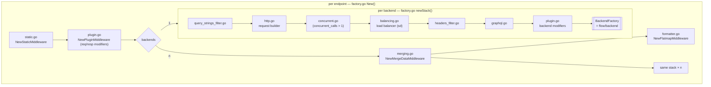

# engine/proxy — the core pipeline

**Code:** [engine/proxy](../../engine/proxy)

The central abstraction of the gateway. Every step in stages 4 and 5 is a **Proxy**:

```go
type Proxy func(ctx context.Context, r *Request) (*Response, error)
type Middleware func(next ...Proxy) Proxy                // wraps one (or many) proxies
type BackendFactory func(*config.Backend) Proxy           // builds the call to one backend (stage 5)
type Factory interface{ New(*config.EndpointConfig) (Proxy, error) } // builds an endpoint pipeline (stage 4)
```

A feature is "a function that takes the next step and returns a new step", so every feature can be added
or removed on its own.

## What `NewDefaultFactory` builds



## Files

| File | Responsibility |
|---|---|
| `proxy.go` | `Proxy`, `Response`, `Metadata`, `Middleware`, errors |
| `request.go` | `Request` (Method, URL, Query, Path, Body, Params, Headers), `Clone`, `CloneRequest` |
| `factory.go` | `NewDefaultFactory`: the diagram above |
| `merging.go` | merge of N backends: parallel (default) or `sequential`, `combiner`, timeout = 85% of endpoint timeout, `sequential_propagated_params` |
| `formatter.go` | entity formatter: `allow`, `deny`, `mapping`, `group`, `target`, `flatmap_filter` (`move`, `append`, `del`) |
| `static.go` | `static` data with strategy `always`, `success`, `errored`, `complete`, `incomplete` |
| `shadow.go` | `NewShadowFactory`: backends with `shadow: true` get a copy of the request, and their result is ignored (`shadow_timeout`) |
| `concurrent.go` | sends the same request `concurrent_calls` times and keeps the first good answer (trades load for tail latency) |
| `balancing.go` | picks a host per call from the `sd` subscriber: round robin when `GOMAXPROCS=1`, otherwise pseudo-random (less lock contention) |
| `headers_filter.go` / `query_strings_filter.go` | forward only listed headers / query strings (backend-level override) |
| `http.go`, `http_response.go` | the default HTTP backend: execute, check status, decode |
| `graphql.go` | turns a backend into a GraphQL query/mutation call |
| `plugin.go`, `plugin/` | req/resp modifier plugins (`plugin/req-resp-modifier`) |
| `register.go` | registry of response combiners |

Endpoint-level options live under `extra_config["inkgate/engine/proxy"]` (alias `proxy`): `sequential`,
`sequential_propagated_params`, `combiner`, `static`, `flatmap_filter`, `shadow`, `shadow_timeout`.

## Merge semantics

- The response is `IsComplete` only if every backend succeeded in time.
- Backends that fail or time out contribute nothing. The client still gets 200 with the partial data.
- Field collisions overwrite in arrival order, so use `group` to keep backends apart.
- For non-GET/HEAD multi-backend endpoints the request body is cloned per backend, so each one reads the full body.
