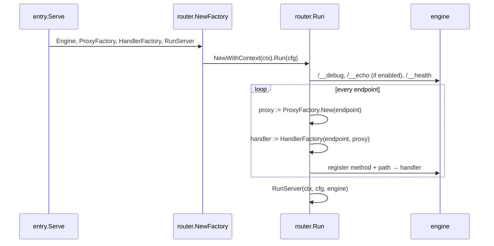

# engine/router — routing

**Code:** [engine/router](../../engine/router) (contract) · [engine/router](../../engine/router) (gorilla/mux implementation)

The contract package holds what the rest of the gateway needs from a router:

| Name | Meaning |
|---|---|
| `Router`, `Factory` | `Run(cfg)` registers endpoints and serves; `NewWithContext(ctx)` builds one |
| `RunServerFunc` | `func(ctx, cfg, http.Handler) error` — starts the server; CORS, OTel and plugins wrap it |
| `Namespace` | `inkgate/engine/router`, alias `router` — the router options in the service `extra_config` |
| `IsValidSequentialEndpoint` | hook for validating non-GET multi-backend endpoints; currently always true |

The gorilla/mux router turns the endpoint list into routes. Each route gets a pipeline (stage 4) and a handler (stage 3):



## Implementation (`engine/router`)

| | |
|---|---|
| routes | `router.go` — `GorillaEngine.Handle(pattern, method)`: one gorilla route per endpoint and method |
| engine + options | `engine.go`, `options.go` — errors, health, redirects |
| endpoint handler | `endpoint.go` `CustomEndpointHandlerWithHTTPError`, `params.go` (gorilla `Vars` → params, `WithParams`, `ClientIP`) |
| renders | `render.go`, `negotiate.go` |
| debug / echo | `debug.go`, `echo.go` |

Full details: [../engine/gateway.md](../engine/gateway.md).

## JSON pass-through (opt-in)

A JSON backend answer is normally decoded and encoded again before it reaches the client. On endpoints where nothing
uses the decoded data, that work can be skipped: the gateway checks the backend's JSON and sends its bytes.

```json
{ "version": 3, "extra_config": { "router": { "json_passthrough": true } } }
```

An endpoint takes it only when everything on it leaves the body alone: one backend with `json` (or no) encoding,
`output_encoding: json`, no `allow`, `deny`, `mapping`, `group`, `target`, `is_collection`, and only `extra_config`
namespaces known to be safe (logging, metrics, rate limits, the JWT validator, the bot detector, JSON-schema, circuit
breaker, HTTP cache, `backend/http`, client credentials). Anything else, a plugin included, keeps decoding. Each
decision is logged at DEBUG: `[ENDPOINT: /users] JSON pass-through: off, mapping`.

The client gets the same status, headers and errors as without it. The body has the same JSON value, as the backend
wrote it: key order, spacing and number formatting are the backend's, and integers above 2^53 keep their exact value.
A 100 KB body is served at 5.4× the rate with half the memory. Design: [../design/json-passthrough.md](../design/json-passthrough.md).

## Path syntax

Endpoints use `{param}` (`/users/{id}`). `cmd/inkgate` sets `config.RoutingPattern = BracketsRouterPatternBuilder`, so endpoints keep `{param}`
and are registered as gorilla/mux route templates (`{id}`, `{id:[0-9]+}`); values come from `mux.Vars`. Parameters go to backends through `url_pattern`
(`/api/users/{id}`). A path must start with `/`, may only use `*` as its last character, and cannot use the reserved
`/__debug`, `/__echo`, `/__health` or `/__ready` prefixes (`invalidPattern` in `engine/config/config.go`).

## Streaming: Server-Sent Events and WebSocket

An endpoint with `router/stream` in its `extra_config` streams instead of answering with one buffered response.
`mode` chooses how:

| `mode` | For | What the gateway does |
|---|---|---|
| `event` (default) | Server-Sent Events, chunked and long-lived responses | copies the backend body to the client and flushes after every chunk |
| `socket` | WebSocket | upgrades the client, opens a WebSocket to the backend and relays the messages both ways |

Common to both modes:

- `timeout` only bounds the wait for the backend (the response headers, or the WebSocket handshake). Once the
  stream is open it lives until the backend ends it or the client disconnects (the backend side is then closed)
- the server `write_timeout` is lifted for this response, other endpoints keep it
- use `"concurrent_calls": 1` and a single backend; response modifiers and merging need the whole body
- on SIGTERM open streams end instead of being cut: an `event` stream finishes as a complete response (the client
  reads to its end), a socket gets a close frame `1001` (going away) on both sides. The shutdown waits for them, up to
  `max_shutdown_wait_time`
- `max_connections` caps the streams or sockets open on the endpoint at once (default: no limit). Over it, the
  request gets `503` with `Retry-After: 1` before the backend is called; the open ones are not affected. Each open
  stream holds a goroutine, two connections and buffers, so set it to what the instance can hold
- `"enabled": false` in the section turns it off without removing it. A section that is not an object (`"router/stream":
  true`), an option that does not exist (`max_conections`), an unknown `mode` or a bad option value stops the gateway at
  startup, and `inkgate check` reports it with the endpoint and, for a typo, the option it looks like

### `mode: "event"` (SSE)

`keep_alive` (for example `"15s"`): when the backend sent nothing for that long, the gateway writes the SSE comment
`: keep-alive`, which every client ignores, so proxies and load balancers in front (often 60 s idle) do not close a
silent stream. Only for `text/event-stream` responses, and only between events: a pause in the middle of an event
waits for its end. Off by default.

```json
{
  "endpoint": "/events",
  "method": "GET",
  "timeout": "3s",
  "output_encoding": "no-op",
  "concurrent_calls": 1,
  "input_headers": ["Accept", "Last-Event-ID"],
  "extra_config": { "router/stream": { "mode": "event" } },
  "backend": [{ "url_pattern": "/sse", "host": ["http://events:9000"], "encoding": "no-op" }]
}
```

- the backend must use `"encoding": "no-op"`; with another encoding the body is decoded as a whole and nothing can
  stream (the endpoint then answers as a normal one)
- for `text/event-stream` it adds `Cache-Control: no-cache` (when the backend sets none) and `X-Accel-Buffering: no`
  so a reverse proxy such as nginx does not buffer it
- pass `Accept` and `Last-Event-ID` in `input_headers` so the backend can resume a stream

### `mode: "socket"` (WebSocket)

```json
{
  "endpoint": "/chat/{room}",
  "method": "GET",
  "timeout": "3s",
  "concurrent_calls": 1,
  "input_headers": ["Authorization"],
  "input_query_strings": ["lang"],
  "extra_config": { "router/stream": { "mode": "socket", "idle_timeout": "60s", "max_message_size": 1048576,
                                       "allowed_origins": ["https://app.example.com"] } },
  "backend": [{ "url_pattern": "/room/{room}", "host": ["http://chat:9100"] }]
}
```

**Code:** [engine/transport/http/socket](../../engine/transport/http/socket), built on `gorilla/websocket`.

- the request goes through the whole pipeline first (JWT validation, rate limit, bot detection, CORS, circuit breaker,
  host load balancing and service discovery), so a socket endpoint is protected like any other
- the gateway connects to the backend **first**. Only when the backend accepts, the client is upgraded and gets the
  subprotocol the backend picked. If the backend refuses (401, 403, 404...), its status, headers and body go to the client
  unchanged. A backend that does not answer within `timeout`, or cannot be reached, gives a 500
- text and binary messages keep their type; **ping, pong and close are forwarded** end to end, and a close keeps its code
  and reason, so both sides see each other's keep-alive and shutdown. A lost connection on one side closes the other
  with 1001
- a request that is not a WebSocket upgrade gets **426** with `Upgrade: websocket`
- `Authorization`, other `input_headers`, the query string and `Origin` are sent to the backend
- `allowed_origins` (for example `["https://app.example.com", "https://*.example.com"]`): an upgrade whose `Origin` is
  not in the list gets **403** before a connection slot is taken or the backend is dialed. Browsers do not apply CORS
  to WebSocket, so `security/cors` does not protect a socket: without this list any site a user visits can open one
  with the user's cookies (cross-site WebSocket hijacking), unless the backend checks `Origin` itself. Scheme, host and
  port must match (default ports may be omitted); `*.` matches subdomains, not the domain itself; `"*"` allows all.
  A request without `Origin` passes: browsers always send it, other clients can send any value. An empty list refuses
  every browser. **Without the option only the same origin is allowed**: the host (and port) of `Origin` must be the
  `Host` of the request, the scheme is not compared (behind a proxy that ends TLS the gateway sees `http`). A page on
  another host gets 403; use the list to allow it, or `["*"]` for the old behaviour. Behind a proxy that rewrites
  `Host`, list the public origin
- `subprotocols` (for example `["graphql-transport-ws"]`): only these of the subprotocols the client offers are passed
  to the backend, in the client's order. A client that offers some and none of these gets **400** before the backend
  is dialed; one that offers none connects without a subprotocol. With or without the list, a backend that answers
  with a subprotocol that was not offered is refused (500) instead of being passed to the client
- options: `idle_timeout` closes the socket when nothing moves in either direction for that long (the client should ping
  more often); `max_message_size` (bytes) closes the connection on a larger message. Both default to no limit
- `max_messages_per_second`: the messages a client may send on one socket, pings included (a ping flood is a message
  flood), with `message_burst` more at once (default: one second of messages, at least 1; each socket starts with a
  full burst). Over it both sides get a close frame **1008** (policy violation, reason `message rate exceeded`), what
  the client sends after it is dropped, and the socket counts under `close.1008`. The endpoint rate limit
  (`qos/ratelimit/router`) counts upgrades, not messages, so without this one connection can send without limit. Messages
  from the backend are not limited. Default: no limit
- permessage-deflate is not negotiated: messages cross the gateway uncompressed
- needs HTTP/1.1 for the client: a WebSocket over HTTP/2 (RFC 8441) is not supported and gets 501
- the connection to a `wss` backend uses the system CA pool
