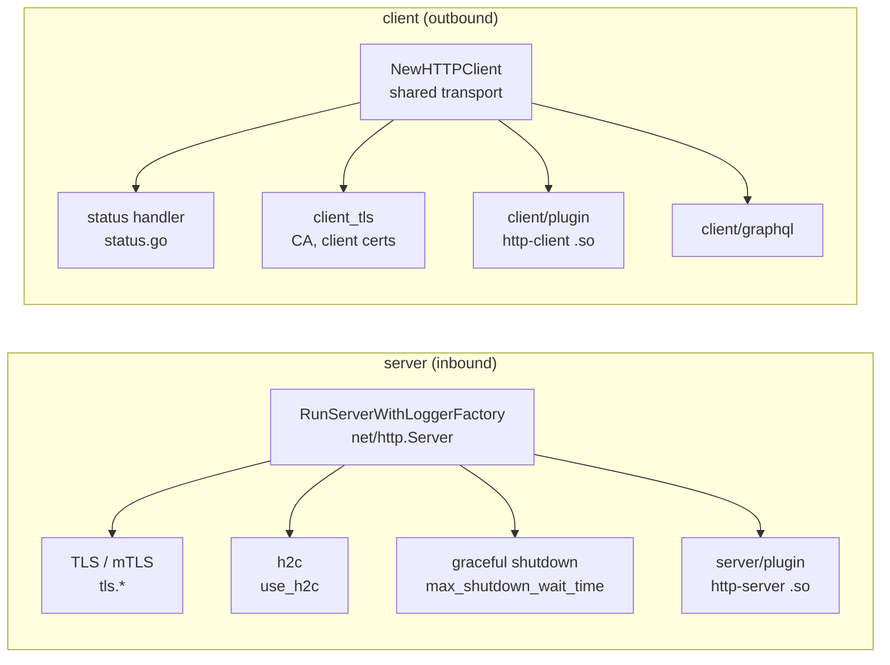

# engine/transport — HTTP in and out

**Code:** [engine/transport/http/server](../../engine/transport/http/server), [engine/transport/http/client](../../engine/transport/http/client)

## Server

| Setting | Meaning |
|---|---|
| `port`, `listen_ip` | where to listen (default `:8080`) |
| `tls` | `public_key`/`private_key` or `keys[]`, `min_version`, `max_version`, `cipher_suites`, `curve_preferences`, `enable_mtls`, `ca_certs`, `disable_system_ca_pool` |
| `use_h2c` | HTTP/2 without TLS |
| `read_timeout`, `write_timeout`, `idle_timeout`, `read_header_timeout`, `max_header_bytes` | `net/http.Server` limits |
| `max_shutdown_wait_time` | how long in-flight requests may finish after SIGTERM |

`DefaultToHTTPError` maps pipeline errors to 500, except for errors that carry their own status code.

## Client

One `http.Transport` is shared by all backends (`NewTransport`), tuned by the service settings
`max_idle_connections`, `max_idle_connections_per_host`, `idle_connection_timeout`, `response_header_timeout`,
`expect_continue_timeout`, `dialer_timeout`, `dialer_keep_alive`, `dialer_fallback_delay`, `disable_keep_alives`,
`disable_compression`, `client_tls`, `allow_insecure_connections`.

### Status handling (`backend/http` alias, `inkgate/engine/transport/http/client`)

| Option | Effect when the backend answers non-2xx |
|---|---|
| none | only 200 and 201 count as success; anything else is an error and the backend is dropped from the merge |
| `return_error_code: true` | the client gets the backend's status code |
| `return_error_details: "name"` | the backend status and body go into the response under the key `error_<name>` |

### GraphQL (`backend/graphql`)

`type` (`query`|`mutation`), `query` or `query_path`, `variables`, `operation`, `method`. The body sent to the
backend is built from these, and the endpoint's params can fill `variables`.
