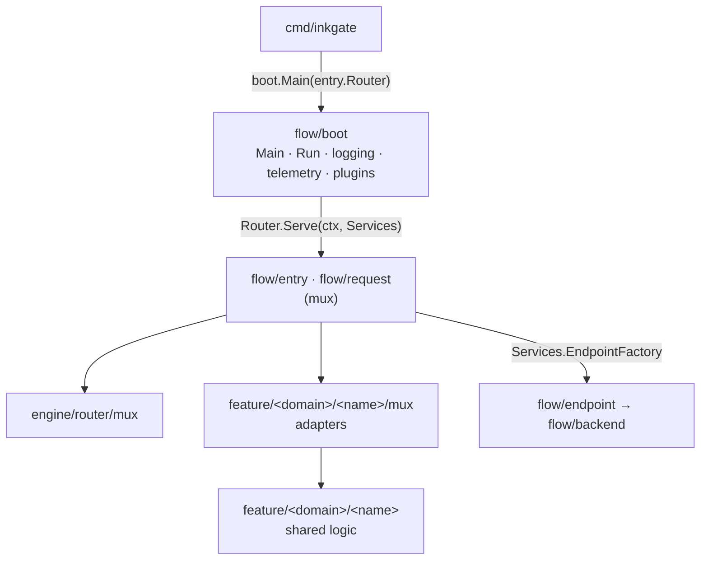

# Engine — inkgate

This project runs the inkgate gateway on the [gorilla/mux](https://github.com/gorilla/mux) router. Details of the router: [mux.md](mux.md).

## What is router-specific

Only the HTTP side touches gorilla/mux. Everything else is router-agnostic and identical in `inkgate-gin`.



| Router-specific (may import gorilla/mux code) | Router-agnostic |
|---|---|
| `cmd/inkgate` | `flow/boot`, `flow/endpoint`, `flow/backend` |
| `flow/entry`, `flow/request` | `feature/**` except the `/mux` adapter folders |
| `engine/router/mux` | `engine/**` except `engine/router/mux` |
| `feature/**/mux` (jose, botdetector, cors, httpsecure, metrics, opencensus, otel, ratelimit, lua, xml) | `internal/**` |

`make check-layout` fails when router-agnostic code imports router-specific code.

## The contract: `boot.Router`

`flow/entry/serve.go` gives boot one value (`flow/boot/router.go`):

```go
type Router struct {
	Name             string                                                                  // "mux"
	NewMetrics       func(ctx, cfg config.ServiceConfig, l logging.Logger) *metrics.Metrics // collector + /__stats server
	RegisterEncoders func()                                                                  // router-specific renders (xml)
	TestRoutes       func(cfg config.ServiceConfig) error                                    // `check --test-routes`
	Serve            func(ctx context.Context, s Services)                                   // build stages 2 + 3, block
}
```

Boot hands back `Services` (config, logger, GELF writer, metrics, JWT rejecter, endpoint factory, agent health
channel). Config parsing, CLI, logging, telemetry, plugins, the endpoint and backend stages and async agents all run
in `flow/boot`.
