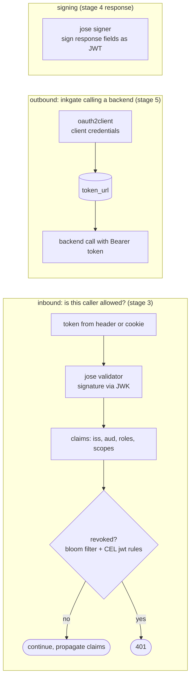

# feature/auth — who is calling, and on whose behalf

**Code:** [feature/auth](../../feature/auth): `jose`, `bloomfilter`, `oauth2client` (+ `internal/auth0` JWK client)

## jose — JWT validation and signing

| | Validator | Signer |
|---|---|---|
| Namespace | `inkgate/feature/auth/jose/validator` | `inkgate/feature/auth/jose/signer` |
| Alias | `auth/validator` | `auth/signer` |
| Where | endpoint `extra_config`, stage 3 step 4 | endpoint `extra_config`, signs fields of the response |
| Code | shared: `feature/auth/jose` (`jose.go`, `jwk_client.go`) · adapter: `feature/auth/jose` | shared: `feature/auth/jose/jws.go` · same adapters |

**Validator options:** `alg`, `jwk_url` (or `jwk_local_path` / `jwk_local_ca`), `cache`, `cache_duration`,
`audience`, `issuer`, `roles`, `roles_key`, `roles_key_is_nested`, `scopes`, `scopes_key`, `scopes_matcher`
(`any`|`all`), `propagate_claims` (claims → backend headers), `propagate_claims_preserve_array`, `cookie_key`,
`auth_header_name`, `leeway`, `key_identify_strategy` (`kid`, `x5t`, `kid_x5t`), `jwk_fingerprints`,
`disable_jwk_security`, `cipher_suites`, `operation_debug`, `failed_jwk_key_cooldown`.

**Signer options:** `alg`, `kid`, `keys_to_sign` (response fields to turn into JWTs), `jwk_url`, `full`,
`disable_jwk_security`, `cipher_suites`.

**Service level:** `shared_cache_duration` enables a JWK cache shared by every endpoint (`jose.SetGlobalCacher`, called at boot).

**Audience:** with `audience` set, the token must contain **every** listed audience (go-jose v4 alone would accept any
one; inkgate keeps the stricter v3 rule). **Algorithms:** a token is accepted only if its `alg` is the configured one;
`none` and unsupported algorithms never get past parsing. **Symmetric keys** (`HS256`, `HS384`, `HS512`) must be at
least 32, 48 and 64 bytes (RFC 7518 section 3.2), for validation and for the signer.

Outcomes: no or invalid token → 401, valid token but missing role or scope → 403.

## bloomfilter — token revocation

| Namespace | `inkgate/feature/auth/bloomfilter` (alias `auth/revoker`), service level |
|---|---|
| Code | `bloomfilter/inkgate` (wiring), `bloomfilter/rotate` (time-rotating filter), `bloomfilter/rpc` (remote add/check API) |
| Options | `n` (expected items), `p` (false-positive rate), `hash_name`, `ttl` (rotation period, seconds), `token_keys` (claims to check, e.g. `jti`), `port` (RPC server) |

At boot, `flow/boot/telemetry.go` (`newTokenRejecter`) creates the filter and starts the RPC server. Another system
adds revoked token keys to it through RPC. Every JWT the validator accepts is then checked against the filter.
A bloom filter can give false positives (a valid token rejected, at rate `p`) but never false negatives.

The rejecter chain also includes **CEL rules whose expression uses `JWT`** (see [validation.md](validation.md)), so a token
can be refused by expression, for example `JWT.sub != 'banned-user'`.

## oauth2client — client credentials to backends

| Namespace | `inkgate/feature/auth/oauth2client` (alias `auth/client-credentials`), backend level |
|---|---|
| Options | `client_id`, `client_secret`, `token_url`, `scopes`, `endpoint_params`, `is_disabled` |
| Where | replaces the plain HTTP client in `flow/backend/backend.go` (`newHTTPClient`) |

inkgate fetches a token from `token_url`, caches it until it expires, and adds `Authorization: Bearer …` to every call
to that backend.
