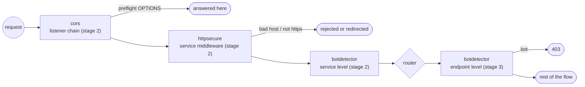

# feature/security — protecting the edge

**Code:** [feature/security](../../feature/security): `cors`, `httpsecure`, `botdetector`

## cors — cross-origin requests

| Namespace | `inkgate/feature/security/cors` (alias `security/cors`), service level |
|---|---|
| Where | `NewRunServer` in `flow/entry/server.go`, wraps the listener, so it runs before routing. The middleware itself is shared: `feature/security/cors/http.go` |
| Adapters | `feature/security/cors/mux` |
| Options | `allow_origins`, `allow_methods`, `allow_headers`, `expose_headers`, `allow_credentials`, `max_age`, `allow_private_network`, `options_passthrough`, `options_success_status`, `debug` |

## httpsecure — secure HTTP headers and host checks

| Namespace | `inkgate/feature/security/httpsecure` (alias `security/http`), service level |
|---|---|
| Where | service level in `flow/entry/engine.go`, the first middleware a request meets |
| Adapters | `feature/security/httpsecure/mux` |
| Options | `allowed_hosts`, `allowed_hosts_are_regex`, `host_proxy_headers`, `ssl_redirect`, `ssl_host`, `ssl_proxy_headers`, `sts_seconds`, `sts_include_subdomains`, `force_sts_header`, `frame_deny`, `custom_frame_options_value`, `content_type_nosniff`, `browser_xss_filter`, `content_security_policy`, `referrer_policy`, `is_development` |

Built on `unrolled/secure`. Typical use: HSTS, `X-Frame-Options`, CSP, and rejecting requests for unknown hosts.

## botdetector — block automated clients by User-Agent

| Namespace | `inkgate/feature/security/botdetector` (alias `security/bot-detector`) |
|---|---|
| Where | service level in `flow/entry/engine.go`, and/or endpoint level as step 2 in `flow/request` |
| Adapters | `feature/security/botdetector/mux` (shared config parser: `feature/security/botdetector/gateway`) |
| Options | `allow` (exact UAs always allowed), `deny` (exact UAs always blocked), `patterns` (regexps), `cache_size` (LRU of decisions), `empty_user_agent_is_bot` |
| Result | 403 |

Order of checks: allow list → deny list → patterns. The decision per User-Agent is cached in an LRU (`internal/lru`).
