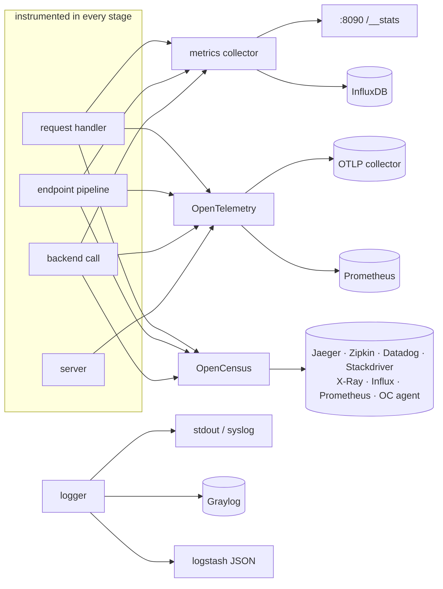

# feature/telemetry — seeing what happens

**Code:** [feature/telemetry](../../feature/telemetry): logging (`gologging`, `gelf`, `logstash`), metrics (`metrics`,
`influx`), tracing (`otel`, `opencensus`), `usage`, `audit`

All telemetry is service level (top-level `extra_config`) and set up in `flow/boot` (`logging.go`, `telemetry.go`).
Each stage has its own step that uses it: request steps 1, 3 and 4, endpoint steps 1-3, backend steps 1-3, and the
HTTP client.

## Logging

| Alias | Namespace | Options |
|---|---|---|
| `telemetry/logging` | `inkgate/feature/telemetry/gologging` | `level` (`DEBUG`…`CRITICAL`), `prefix`, `stdout`, `syslog`, `syslog_facility`, `format` (`default`, `logstash`, `custom`), `custom_format` |
| `telemetry/gelf` | `inkgate/feature/telemetry/gelf` | `address`, `enable_tcp` |
| `telemetry/logstash` | `inkgate/feature/telemetry/logstash` | no options: its presence switches the output to logstash JSON lines; level and prefix come from `telemetry/logging` |

Selection (`flow/boot/logging.go`): logstash if configured, otherwise gologging (with GELF as an extra writer),
otherwise a plain DEBUG logger on stdout.

## Metrics

| Alias | Namespace | Options |
|---|---|---|
| `telemetry/metrics` | `inkgate/feature/telemetry/metrics` | `collection_time`, `listen_address` (default `:8090`), `proxy_disabled`, `router_disabled`, `backend_disabled`, `endpoint_disabled` |
| `telemetry/influx` | `inkgate/feature/telemetry/influx` | `address`, `username`, `password`, `db`, `ttl`, `buffer_size` |

The collector counts requests, statuses and latency per endpoint and backend, plus Go runtime stats. It serves a
JSON snapshot on its own port. Influx pushes the same data periodically.

### Stream and socket metrics

With `telemetry/metrics` on (and router metrics not disabled), every streaming endpoint (`router/stream`) reports
under `router.stream.<endpoint>.`:

| Metric | Kind | Meaning |
|---|---|---|
| `open` | counter, up and down | streams or sockets open now |
| `opened`, `refused` | counters | started, and refused over `max_connections` |
| `duration` | histogram (ns) | how long each lasted |
| `messages.to_client`, `messages.from_client` | counters | socket messages, event-stream chunks |
| `bytes.to_client`, `bytes.from_client` | counters | their size |
| `close.<code>` | counters | how sockets ended: `1000` normal, `1001` server shutdown, `1006` dropped without a close frame, `1008` over `max_messages_per_second` |

Not exported through OpenTelemetry yet: the engine reports to a `router.StreamObserver`, and only the metrics layer
implements one so far.

## Tracing and metrics export

| Alias / namespace | Options |
|---|---|
| `telemetry/opentelemetry` | `service_name`, `service_version`, `deploy_env`, `metric_reporting_period`, `trace_sample_rate`, `exporters.otlp[]` (`name`, `host`, `port`, `use_http`, `disable_metrics`, `disable_traces`), `exporters.prometheus[]`, `layers.global` / `.proxy` / `.backend` (`disable_metrics`, `disable_traces`, `report_headers`, `round_trip`, `read_payload`, `detailed_connection`, `static_attributes`), `skip_paths`, `disable_propagation` |
| `telemetry/opencensus` (`inkgate/feature/telemetry/opencensus`) | `sample_rate`, `reporting_period`, `enabled_layers` (`router`, `pipe`, `backend`), `exporters` (`jaeger`, `zipkin`, `datadog`, `stackdriver`, `xray`, `influxdb`, `prometheus`, `ocagent`, `logger`) |

OpenCensus is deprecated upstream and kept for parity. For new setups use OpenTelemetry.

## usage

`feature/telemetry/usage` sends anonymous usage stats (cluster ID hash, version, uptime and an audit summary) 5 s
after start, **only when `INKGATE_USAGE_URL` is set** (the report server). Unset, nothing is sent.

## audit

`feature/telemetry/audit` backs the `audit` command of both binaries. It turns the config into a compact bit-vector
description (`audit.Parse`), runs about 40 rules on it (`rules.go`, for example `hasNoTLS`, `hasDebugEnabled`, `hasNoRatelimit`, `hasNoCB`,
`hasNoJWT`, `hasNoCORS`, `hasEndpointWildcard`, `hasUnlimitedCache`, `hasDeprecatedOpenCensus`) and prints the
findings with severities.
