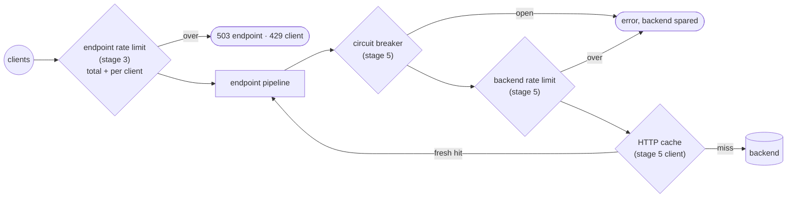
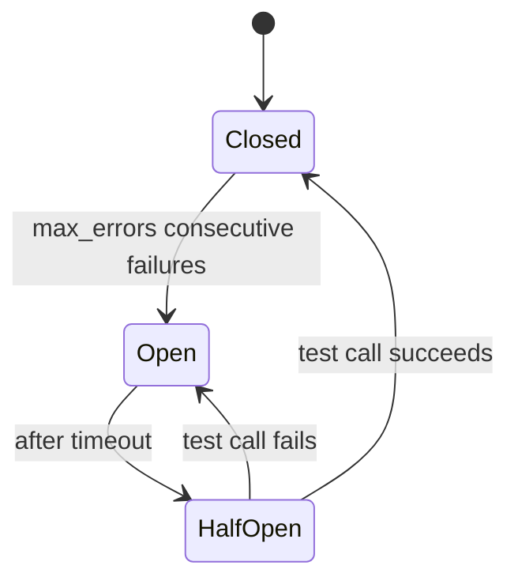

# feature/traffic — protecting inkgate and the backends from overload

**Code:** [feature/traffic](../../feature/traffic): `ratelimit`, `circuitbreaker`, `httpcache` (+ `internal/httpcache`)

## ratelimit — token buckets

| | Endpoint (router) | Backend (proxy) |
|---|---|---|
| Namespace | `qos/ratelimit/router` | `qos/ratelimit/proxy` |
| Where | stage 3 step 7 | stage 5 step 5 |
| Code | shared config + buckets: `feature/traffic/ratelimit/router` · adapter: `feature/traffic/ratelimit/router` | `feature/traffic/ratelimit/proxy` (shared) |
| Result | 503 when the endpoint limit is hit, 429 when a client limit is hit | error (the backend is not called) |

**Endpoint options:** `max_rate` + `capacity` (whole endpoint), `client_max_rate` + `client_capacity` (per client),
`strategy` for identifying the client (`ip`, `header` or `param`, with `key` naming the header or param), `every`
(the period of `max_rate`, default `1s`), `num_shards`, `cleanup_period`, `cleanup_threads` (memory housekeeping
of per-client buckets).

**Backend options:** `max_rate`, `capacity`.

Buckets are in memory and per instance. With N inkgate instances the effective limit is N × the configured rate.

## circuitbreaker — stop calling a failing backend

| Namespace | `inkgate/feature/traffic/circuitbreaker/gobreaker` (alias `qos/circuit-breaker`), backend level |
|---|---|
| Where | stage 5 step 4 |
| Options | `interval` (seconds, counting window), `timeout` (seconds open before trying again), `max_errors` (consecutive errors that open the circuit), `name`, `log_status_change` |

An `eapache` implementation (`inkgate/feature/traffic/circuitbreaker/eapache`) is also included but not wired in
`flow/backend`.

## httpcache — cache backend responses

| Namespace | `inkgate/feature/traffic/httpcache` (alias `qos/http-cache`), backend level |
|---|---|
| Where | the HTTP client built in `flow/backend/backend.go` `newHTTPClient` |
| Options | `shared` (one cache for every backend that has the same URL), `max_items`, `max_size` |

The cache honours the backend's `Cache-Control` headers. It only applies to HTTP backends.
