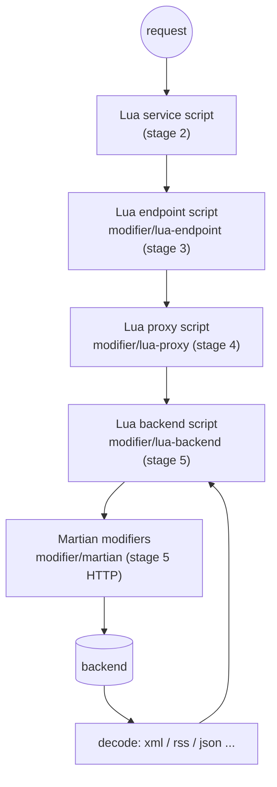

# feature/transform — changing requests and responses

**Code:** [feature/transform](../../feature/transform): `lua`, `martian`, `xml`, `rss` (+ `internal/binder` Lua bridge, `internal/flatmap/tree`)



## lua — scripts at any stage

| Alias | Namespace | Where | Script sees |
|---|---|---|---|
| `modifier/lua-endpoint` | `inkgate/feature/transform/lua/router` | stage 2 (service) and stage 3 (endpoint); adapter `feature/transform/lua/router` | the HTTP request: `ctx` |
| `modifier/lua-proxy` | `inkgate/feature/transform/lua/proxy` | stage 4 | `request` and `response` objects |
| `modifier/lua-backend` | `inkgate/feature/transform/lua/proxy/backend` | stage 5 | `request` and `response` of one backend |

**Options:** `sources` (Lua files to load), `pre` (code run before the call), `post` (code run on the response),
`live` (reload sources on every request, for development), `allow_open_libs` (enable Lua's `io`, `os` and so on),
`skip_next` (answer from the script and don't call the next step), `md5` (checksums of the sources).

The Lua VM is `gopher-lua`, and Go types are exposed through `internal/binder`. Helpers available to scripts are in
`lua/decorator` (http, json, logging, etc.). A script can stop the request with `custom_error(msg, status)`.

The response body is a table: read it with `resp:data()` and change it with the table methods, or set one field with
the two-argument form. Both forms convert strings, numbers, booleans and tables the same way.

```lua
local resp = response.load()
local data = resp:data()          -- the body as a table
data:set("id", data:get("id") + 1)
data:del("internal")
resp:data("source", "lua")        -- same as resp:data():set("source", "lua")
resp:headers("X-Lua", "yes")      -- one response header (nil removes it)
```

**Lua states are reused** (`modifier/lua-proxy`, `modifier/lua-backend`). Building a Lua state is most of the cost of
a script, so each endpoint keeps a pool of prepared states and compiles its code once. Every request still starts
clean: the `sources` run again (their `local` variables are new), globals a script created or changed are put back,
and `request`/`response` are those of the current request. What can survive on a state: a table reached through a
global the script did not create and changed in place, and modules loaded with `require` (cached as in any Lua
program). Do not keep per-request state there. `response.load()` fails in a `pre` script: there is no response yet.
With `"live": true` every request builds a fresh state from the files on disk, as before. Code that does not compile
is reported once at startup, and every request then fails with the same error as before.

## martian — declarative HTTP modifiers

| Namespace | `inkgate/feature/transform/martian` (alias `modifier/martian`), backend level |
|---|---|
| Where | wraps the HTTP client in stage 5 (`martian.NewConfiguredBackendFactory`) |
| Value | a Google Martian modifier tree, e.g. `header.Modifier`, `querystring.Modifier`, `body.Modifier`, `fifo.Group`, `cookie`, `stash`, `status`, `port`, `priority`, `url` |

Use it to add, rename or remove headers, query strings or the body without code.

## xml and rss — more encodings

Registered at boot (`flow/boot/encoding.go`):
- `xml`: backend `encoding: "xml"` decodes XML; endpoint `output_encoding: "xml"` renders XML (`feature/transform/xml`, registered by `entry.Router`).
- `rss`: backend `encoding: "rss"` decodes RSS/Atom feeds.

## flatmap (internal)

`internal/flatmap/tree` implements `flatmap_filter` operations (`move`, `append`, `del`) on nested arrays with `*`
wildcards. It is used by `engine/proxy/formatter.go` (see [../engine/proxy.md](../engine/proxy.md)).
