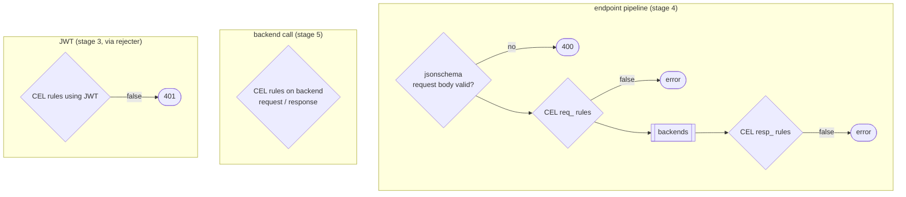

# feature/validation — business rules on data

**Code:** [feature/validation](../../feature/validation): `cel`, `jsonschema`

## cel — Common Expression Language rules

| Namespace | `inkgate/feature/validation/cel` (alias `validation/cel`), endpoint or backend level |
|---|---|
| Value | a list of rules: `[{ "check_expr": "<CEL expression>" }]` |
| Where | stage 4 step 5 (`cel.ProxyFactory`), stage 5 step 7 (`cel.BackendFactory`), JWT rejecter (`cel.NewRejecter`) |

The variables available in an expression depend on where it runs: `req_method`, `req_path`, `req_params`,
`req_headers`, `req_querystring` before the call; `resp_data`, `resp_metadata_status`, `resp_metadata_headers`,
`resp_completed` after the call; `JWT` (the claims) in the rejecter; and `now` (the current time) everywhere. An expression that evaluates to `false` stops the request. Any rule that uses
`resp_` runs on the response, after the call.

Example: only allow a call during office hours, or reject a response that is missing a field.

## jsonschema — validate the request body

| Namespace | `inkgate/feature/validation/jsonschema` (alias `validation/json-schema`), endpoint level |
|---|---|
| Value | a JSON Schema document (the whole namespace value is the schema) |
| Where | stage 4 step 6 |
| Result | 400 with the validation error, backends are not called |

Uses `santhosh-tekuri/jsonschema`.
