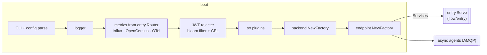

# Stage 1 — boot

**Code:** [flow/boot](../../flow/boot) · **Entry points:** `boot.Main(router)`, `boot.Run(ctx, cfg, router)`
· **Runs:** once per process

Boot turns the command line and the config file into a running gateway. It does every router-independent job once,
then asks `entry.Router` (a `boot.Router`) to build and serve the HTTP side.

## Files

| File | Responsibility |
|---|---|
| `main.go` | `Main(r Router)`: signals, encoders, config aliases, parser choice (flexible config or koanf), CLI commands; sets `cli.RunRouterFunc = r.TestRoutes` |
| `router.go` | the contract with the HTTP side: `Router` (Name, NewMetrics, RegisterEncoders, TestRoutes, Serve) and `Services` |
| `boot.go` | `NewExecutor` and `Run`, the numbered startup checklist |
| `logging.go` | `newLogger`: logstash → gologging → stdout, plus the GELF writer |
| `telemetry.go` | `registerTelemetry` (Influx, OpenCensus, OTel), `newTokenRejecter` |
| `plugins.go` | `LoadPluginsWithContext` and the `test-plugin` command |
| `encoding.go` | `RegisterEncoders`: XML and RSS decoders (renders are registered by `entry.Router`) |

## `Run` step by step

1. **Logging.** If the logger can't be built, `Run` returns. Then it logs `Starting inkgate v<version>`,
   and logs the working directory.
2. **Global settings and plugins.** DNS SRV cache TTL (`dns_cache_ttl`); `.so` plugins from `plugin.folder`.
3. **Shared services.** `r.NewMetrics` creates the collector (and serves `/__stats` with its own router). `registerTelemetry` starts the exporters and returns a shutdown func. `newTokenRejecter` builds the
   revocation check used by the JWT validator.
4. **Shared stages.** `backend.NewFactory` then `endpoint.NewFactory`.
5. **Serve.** `r.Serve(ctx, Services)` builds stages 2 and 3 and blocks. With `async_agent`, the agents run in the
   same `errgroup`; `sequential_start: true` starts them before the router.

## `Services` (what entry receives)

| Field | Meaning |
|---|---|
| `Config` | the parsed, normalized `ServiceConfig` |
| `Logger`, `LogWriter` | the logger; the GELF writer or nil |
| `Metrics` | the shared collector (`feature/telemetry/metrics`); `flow/entry` wraps it for request metrics (`feature/telemetry/metrics`) |
| `TokenRejecter` | JWT revocation check for the jose adapter |
| `EndpointFactory` | builds stage 4 (and stage 5 inside it) for an endpoint |
| `AgentPing` | async agents report here; the health endpoint shows them |
