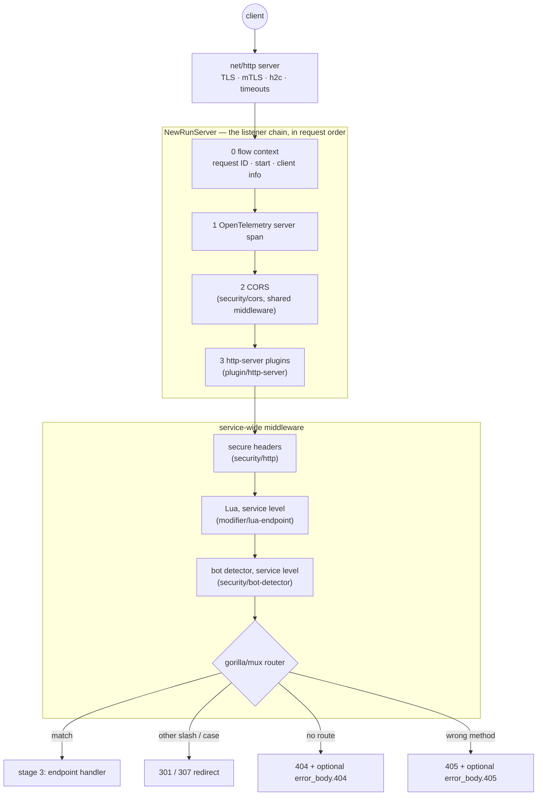

# Stage 2 — entry

**Code:** [flow/entry](../../flow/entry) · **Runs:** listener once, middleware on every request

Everything that applies to the whole service, before the gorilla/mux router picks an endpoint.

## Files

| File | Responsibility |
|---|---|
| `server.go` | `NewRunServer`: net/http server → flow context → OpenTelemetry → CORS → http-server plugins; `withFlowContext` creates the flow ([../overview/flow-context.md](../overview/flow-context.md)) and logs a `[FLOW]` summary |
| `engine.go` | `NewMiddlewares`: httpsecure, Lua and bot detector as `mux.HandlerMiddleware`s, in request order |
| `serve.go` | `Router` (the `boot.Router` value) and `Serve`: handler factory, `mux.NewEngine(cfg)` (gorilla router with 404/405, redirects, options), health handler, `NewRunServer` |

## Details

- **CORS runs before the router**, so preflight `OPTIONS` requests are answered even for paths with no endpoint.
- **http-server plugins** wrap the router handler (with the service-wide middleware). They run after the flow
  context, OTel and CORS, so they can read the flow (see [../overview/flow-context.md](../overview/flow-context.md#plugins)).
- Built-in endpoints: `/__health` (unless `disable_health`), `/__debug/` (`debug_endpoint: true` or `run -d`),
  `/__echo/` (`echo_endpoint: true`).
- Custom 404/405 bodies come from `extra_config["inkgate/engine/router"].error_body` (alias `router`). Without them
  the body is `404 page not found` / `405 method not allowed`, with `X-Inkgate-Completed: false`.
- Router options, client IP and other gorilla/mux details: [../engines/mux.md](../engines/mux.md).
