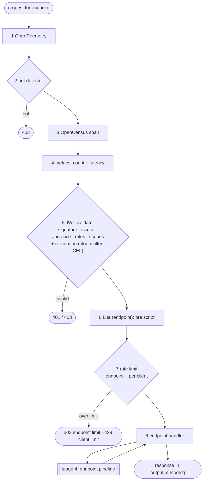

# Stage 3 — request

**Code:** [flow/request/request.go](../../flow/request/request.go) · **Entry point:** `request.NewHandlerFactory`
· **Runs:** built once per endpoint, executed on every request to that endpoint

The router found the endpoint. Now inkgate decides whether this request may continue, then converts it into a
`proxy.Request` for the endpoint pipeline.

## Steps

| # | Step | Shared logic | Router code | Namespace (alias) |
|---|---|---|---|---|
| 1 | OpenTelemetry | `feature/telemetry/otel` | `feature/telemetry/otel` | `telemetry/opentelemetry` |
| 2 | bot detector | `feature/security/botdetector` | `feature/security/botdetector/gateway` | `security/bot-detector` |
| 3 | OpenCensus span | `feature/telemetry/opencensus` | `feature/telemetry/opencensus` | `telemetry/opencensus` |
| 4 | request metrics | `feature/telemetry/metrics` | `feature/telemetry/metrics` | `telemetry/metrics` |
| 5 | JWT validation | `feature/auth/jose` | `feature/auth/jose` | `auth/validator` |
| 6 | Lua endpoint script | `feature/transform/lua/router` | `feature/transform/lua/router` | `modifier/lua-endpoint` |
| 7 | rate limit | `feature/traffic/ratelimit/router` | `feature/traffic/ratelimit/router` | `qos/ratelimit/router` |
| 8 | endpoint handler | `engine/proxy` | `engine/router` `CustomEndpointHandlerWithHTTPError` + `NewRequestWithPathParams` | endpoint fields |

Each step returns the next handler unchanged when its namespace is absent from the endpoint's `extra_config`.

## Step 8: the endpoint handler

1. Builds a `proxy.Request` with the method, path params, body, and **only** the headers listed in `input_headers`
   and the query strings listed in `input_query_strings` (deny by default). Path params are Title-cased (`id` → `Id`).
   JWT claims used as `{{.JWT.<claim>}}` in a backend `url_pattern` are added as params by step 5.
2. Records the endpoint and path params in the flow context, applies the endpoint `timeout` and calls stage 4.
3. Writes the response: status, `Cache-Control` from `cache_ttl`, `X-Inkgate-Completed`, the body rendered with
   `output_encoding` (`json`, `json-collection`, `xml`, `yaml`, `string`, `negotiate`, `no-op`).
4. On error: the error's own status, or 500 (`server.DefaultToHTTPError`). The error text is written only with
   router option `return_error_msg: true`.
