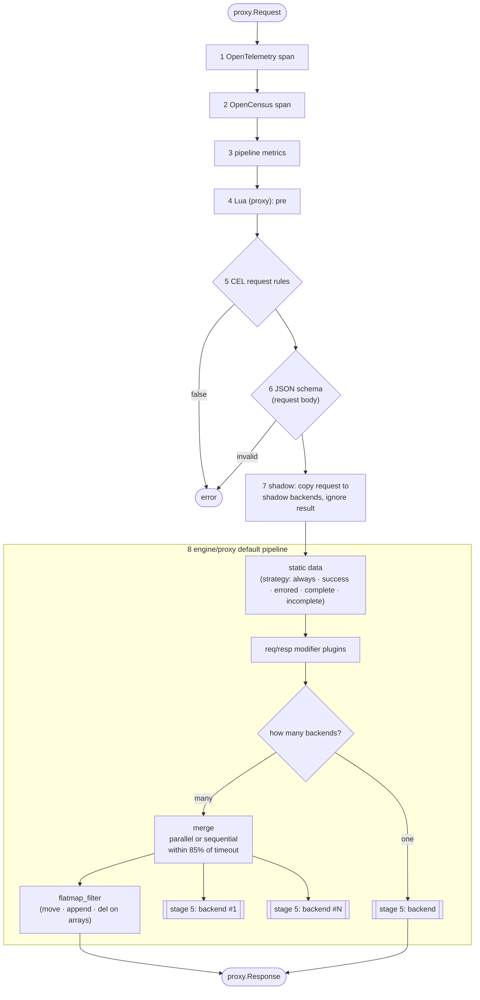

# Stage 4 — endpoint

**Code:** [flow/endpoint/endpoint.go](../../flow/endpoint/endpoint.go) · **Entry point:** `endpoint.NewFactory`
· **Runs:** built once per endpoint, executed on every request

The business heart of the gateway. One request comes in, it is validated and transformed, sent to every backend
of the endpoint, and the answers are merged into one response.

Response-side work runs on the way back up: CEL response rules (5), Lua post scripts (4) and metrics/spans close.

## Steps

| # | Step | Code | Config |
|---|---|---|---|
| 1 | OpenTelemetry pipeline span | `feature/telemetry/otel/pipeline` | `telemetry/opentelemetry` (service) |
| 2 | OpenCensus span | `feature/telemetry/opencensus` | `telemetry/opencensus` (service) |
| 3 | pipeline metrics | `feature/telemetry/metrics` | `telemetry/metrics` (service) |
| 4 | Lua proxy script | `feature/transform/lua/proxy` | endpoint `modifier/lua-proxy` |
| 5 | CEL rules | `feature/validation/cel` | endpoint `validation/cel` |
| 6 | JSON schema | `feature/validation/jsonschema` | endpoint `validation/json-schema` |
| 7 | shadow backends | `engine/proxy/shadow.go` | backend `proxy.shadow: true`, `shadow_timeout` |
| 8 | default pipeline | `engine/proxy/factory.go` | see below |

## The default pipeline (step 8)

Built by `proxy.NewDefaultFactory` in `engine/proxy/factory.go`. Details are in [../engine/proxy.md](../engine/proxy.md).

- **Static data** (`proxy.static`): adds fixed data to the response, depending on the strategy. Useful as a fallback when backends fail.
- **Modifier plugins** (`plugin/req-resp-modifier`): Go `.so` plugins that can change the request and the response.
- **Merge** (only with 2+ backends): calls backends **in parallel** by default. With `proxy.sequential: true` they
  run one after another, and a later backend URL can use values from an earlier response (`{resp0_field}`).
  A custom `proxy.combiner` can replace the default merge.
  Missing or failed backends make the response *incomplete*. They don't cause an error.
- **Flatmap** (`proxy.flatmap_filter`): array operations on the merged data.

Each backend of the endpoint gets its own stage-5 pipeline.
