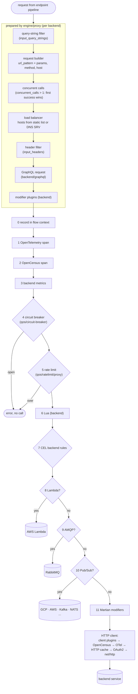

# Stage 5 — backend

**Code:** [flow/backend/backend.go](../../flow/backend/backend.go) · **Entry point:** `backend.NewFactory`
· **Runs:** built once per backend, executed on every call to that backend

One call from inkgate to one backend service. The core pipeline prepares the call first. Then inkgate's backend
steps protect, observe and transform it, and finally a connector (HTTP, Lambda, AMQP or Pub/Sub) performs it.

## Steps

| # | Step | Code | Config (backend `extra_config`) |
|---|---|---|---|
| 0 | record the call in the flow context (+ request ID header when `propagate_request_id`) | `flow/backend/flow.go` `recordFlow` | service `context` |
| 1 | OpenTelemetry span | `feature/telemetry/otel/pipeline` | service `telemetry/opentelemetry` |
| 2 | OpenCensus span | `feature/telemetry/opencensus` | service `telemetry/opencensus` |
| 3 | backend metrics | `feature/telemetry/metrics` | service `telemetry/metrics` |
| 4 | circuit breaker | `feature/traffic/circuitbreaker/gobreaker/proxy` | `qos/circuit-breaker` |
| 5 | rate limit | `feature/traffic/ratelimit/proxy` | `qos/ratelimit/proxy` |
| 6 | Lua backend script | `feature/transform/lua/proxy` | `modifier/lua-backend` |
| 7 | CEL rules | `feature/validation/cel` | `validation/cel` |
| 8 | Lambda | `feature/connector/lambda` | `backend/lambda` |
| 9 | AMQP | `feature/connector/amqp` | `backend/amqp/consumer`, `backend/amqp/producer` |
| 10 | Pub/Sub | `feature/connector/pubsub` | `backend/pubsub/publisher`, `backend/pubsub/subscriber` |
| 11 | Martian + HTTP | `feature/transform/martian`, `engine/transport/http/client` | `modifier/martian`, `backend/http`, `qos/http-cache`, `auth/client-credentials`, `plugin/http-client` |

Steps 8-10 are **connectors**. Each one checks its namespace. If the namespace is there, the connector makes the call
itself and the steps below it never run. Otherwise it passes the call down. A backend with no connector namespace
is a normal HTTP backend.

## After the response

On the way back, `engine/proxy` decodes the body with the backend `encoding` (`json`, `safejson`, `xml`, `rss`,
`string`, `no-op`), then shapes it:

| Field | Effect |
|---|---|
| `allow` / `deny` | keep only / drop these fields (dot notation for nesting) |
| `mapping` | rename fields |
| `group` | wrap the whole response under this key (avoids collisions when merging) |
| `target` | use only this sub-object of the response |
| `is_collection` | the backend returns an array; wrap it under `collection` |

Status handling (`backend/http`): by default only 200 and 201 are success; any other status is an error. With `return_error_code` or
`return_error_details` the backend status and body are passed to the client.
