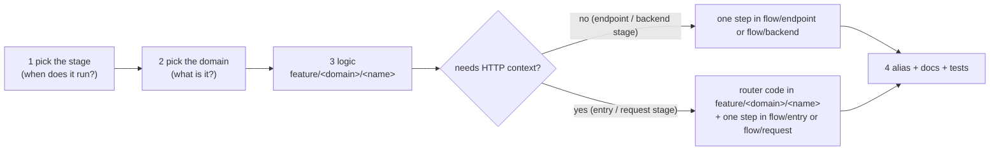

# Adding a feature

Example: a header `X-Request-Source` that must be present on some endpoints (a request-stage check).



## 1. Pick the stage

| Runs on... | Stage | Where | Step type |
|---|---|---|---|
| every request, before routing | entry | `flow/entry` | `router.HandlerMiddleware`, or a `RunServerFunc` wrapper |
| requests to one endpoint, with HTTP context (headers, status codes) | request | `flow/request` | `func(router.HandlerFactory) router.HandlerFactory` (`engine/router`) |
| the endpoint's data (request and merged response) | endpoint | `flow/endpoint` | `func(proxy.Factory) proxy.Factory` |
| one backend call | backend | `flow/backend` | `func(proxy.BackendFactory) proxy.BackendFactory` |
| once at startup | boot | `flow/boot` | a function called from `Run` |

Our header check needs the HTTP request and should answer 400, so it goes in **request**: the logic in a
feature package, with its router code in a separate file of the same package.

## 2. Pick the domain

`auth`, `security`, `validation`, `traffic`, `transform`, `connector` or `telemetry`. A required header is
**validation**: `feature/validation/requireheader`.

## 3. Write the logic, then the router code

Router-agnostic (`feature/validation/requireheader/requireheader.go`):

```go
package requireheader

import "github.com/9edang/inkgate/engine/config"

const Namespace = "inkgate/feature/validation/requireheader"

// HeaderFor returns the header the endpoint requires, or "" when the feature is off.
func HeaderFor(cfg *config.EndpointConfig) string {
	v, _ := cfg.ExtraConfig[Namespace].(map[string]interface{})
	name, _ := v["header"].(string)
	return name
}
```

Router code (`feature/validation/requireheader/router.go`):

```go
package requireheader

import (
	"net/http"

	"github.com/9edang/inkgate/engine/config"
	"github.com/9edang/inkgate/engine/proxy"
	"github.com/9edang/inkgate/engine/router"
)

func HandlerFactory(next router.HandlerFactory) router.HandlerFactory {
	return func(cfg *config.EndpointConfig, p proxy.Proxy) http.HandlerFunc {
		h := next(cfg, p)
		name := HeaderFor(cfg)
		if name == "" {
			return h
		}
		return func(w http.ResponseWriter, r *http.Request) {
			if r.Header.Get(name) == "" {
				w.WriteHeader(http.StatusBadRequest)
				return
			}
			h(w, r)
		}
	}
}
```

Rules every feature follows:
- **Logic in its own file, translation in the router file.** The router file only reads the request and writes the
  response.
- **Read only your own namespace.** If it's absent, return `next` unchanged, so the feature costs nothing.
- **Parse config once,** in the factory, not per request.
- **Share request data through the flow context**: `context.From(ctx)` (or `context.From(r.Context())` in the
  router file) to read the request ID, claims or params, and `Set`/`Get` for values another layer needs.

## 4. Add one step

In `flow/request/request.go`, at the position it should run (for example right after JWT validation):

```go
		requireheader.HandlerFactory, // 6. required headers
```

(import `github.com/9edang/inkgate/feature/validation/requireheader`) and renumber the step comments that
follow it.

## 5. Alias, docs, tests

- Optional short alias: add `"inkgate/feature/validation/requireheader": "validation/require-header"` to `aliases`
  in `flow/boot/main.go`.
- Add a row to [config-reference.md](config-reference.md), a section to the domain page in `docs/feature/`, and the
  step to `docs/flow/3-request.md`.
- Unit-test the router code with `httptest`; add an integration spec in `tests/fixtures/specs/`.
