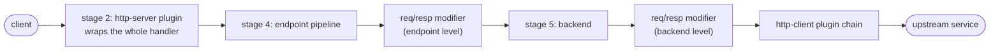
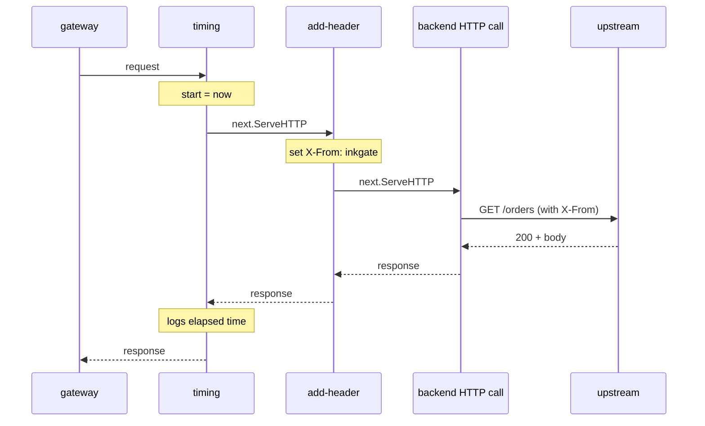
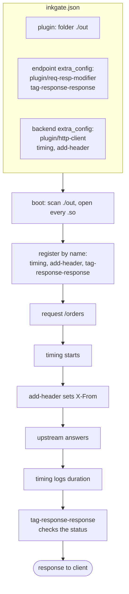

# Writing custom plugins

A plugin is a Go program compiled to a `.so` file. inkgate loads it at boot, so you add your own code to the gateway
without forking it. This guide goes from an empty folder to two plugins working together on one request.

Reference: [engine/async-and-plugins](../engine/async-and-plugins.md). Config keys: [config-reference](config-reference.md).

## 1. Pick the plugin type

| You want to... | Type | Config alias | Symbol your `.so` must export |
|---|---|---|---|
| wrap the whole HTTP handler (auth, CORS, logging of every request) | http-server | `plugin/http-server` | `HandlerRegisterer` |
| change or replace the call to one backend | http-client | `plugin/http-client` | `ClientRegisterer` |
| edit the request or the response of an endpoint or a backend | req/resp modifier | `plugin/req-resp-modifier` | `ModifierRegisterer` |

One `.so` can export several symbols, so one file can hold a client and a modifier.

## 2. Rules that make or break the build

- The package must be `package main` with an empty `func main() {}`.
- Import `github.com/9edang/inkgate/context`, not the standard `context`. It is the same type (an alias), but the
  whole project imports it this way.
- Build with **the same Go version and the same dependency versions** as the inkgate binary. If not, loading fails
  with `plugin was built with a different version of package ...`.
- Build with `CGO_ENABLED=1` (the default when a C compiler is installed). Go plugins work on Linux and macOS only.
- Export a **variable** (`var ClientRegisterer = ...`), not a function. The loader looks the symbol up by name.

## 3. Project layout

```
my-plugins/
├── go.mod
├── go.sum
├── add-header/main.go     # plugin 1
├── timing/main.go         # plugin 2
└── out/                   # the .so files end up here
```

For a plugin outside the inkgate repository, point the module at your inkgate checkout:

```
# go.mod
module example.com/my-plugins

go 1.27.4

require github.com/9edang/inkgate v0.0.0

replace github.com/9edang/inkgate => /path/to/inkgate
```

Then run `go mod tidy`. With the `replace` line the plugin gets exactly the dependency versions of that checkout.
Copy the `go` line from inkgate's own `go.mod` (1.27.4 at the time of writing): it is the minimum Go that builds
inkgate, and the plugin must be built with the same Go release as the binary that loads it.

## 4. Example 1: an http-client plugin that adds a header

`add-header/main.go`, written as a middleware: it receives `next`, does its work, and calls `next.ServeHTTP` to
continue the chain.

```go
package main

import (
	"net/http"

	"github.com/9edang/inkgate/context"
)

// ClientRegisterer is the symbol inkgate looks up in the .so file.
var ClientRegisterer = registerer("add-header")

type registerer string

var logger Logger

// RegisterLogger is optional; inkgate calls it before RegisterClients.
func (registerer) RegisterLogger(v any) {
	if l, ok := v.(Logger); ok {
		logger = l
	}
}

// RegisterClients registers the chainable form: it receives next and wraps it.
func (r registerer) RegisterClients(f func(
	name string,
	handler func(context.Context, map[string]any, http.Handler) (http.Handler, error),
)) {
	f(string(r), r.build)
}

func (r registerer) build(_ context.Context, extra map[string]any, next http.Handler) (http.Handler, error) {
	// settings live under the plugin's own name inside "plugin/http-client"
	cfg, _ := extra[string(r)].(map[string]any)
	key, _ := cfg["header"].(string)
	value, _ := cfg["value"].(string)
	if key == "" {
		key, value = "X-Plugin", "add-header"
	}

	return http.HandlerFunc(func(w http.ResponseWriter, req *http.Request) {
		req.Header.Set(key, value)
		if logger != nil {
			logger.Debug("add-header:", req.Method, req.URL.Path)
		}
		next.ServeHTTP(w, req)
	}), nil
}

func main() {}

type Logger interface {
	Debug(v ...any)
	Info(v ...any)
	Warning(v ...any)
	Error(v ...any)
	Critical(v ...any)
	Fatal(v ...any)
}
```

## 5. Example 2: a second http-client plugin that measures time

`timing/main.go`. The code after `next.ServeHTTP` runs when everything listed after this plugin has finished, so it
measures them all.

```go
package main

import (
	"net/http"
	"time"

	"github.com/9edang/inkgate/context"
)

// ClientRegisterer is the symbol inkgate looks up in the .so file.
var ClientRegisterer = registerer("timing")

type registerer string

var logger Logger

func (registerer) RegisterLogger(v any) {
	if l, ok := v.(Logger); ok {
		logger = l
	}
}

func (r registerer) RegisterClients(f func(
	name string,
	handler func(context.Context, map[string]any, http.Handler) (http.Handler, error),
)) {
	f(string(r), r.build)
}

func (registerer) build(_ context.Context, _ map[string]any, next http.Handler) (http.Handler, error) {
	return http.HandlerFunc(func(w http.ResponseWriter, req *http.Request) {
		start := time.Now()
		next.ServeHTTP(w, req) // everything listed after "timing" runs inside this call
		if logger != nil {
			logger.Debug("timing:", req.URL.Path, time.Since(start))
		}
	}), nil
}

func main() {}

type Logger interface {
	Debug(v ...any)
	Info(v ...any)
	Warning(v ...any)
	Error(v ...any)
	Critical(v ...any)
	Fatal(v ...any)
}
```

## 6. Example 3: a response modifier

A modifier registers a **factory** per direction. The factory runs once at boot and returns the function that runs on
every request or response. Return an error from that function to fail the call.

```go
package main

import "errors"

// ModifierRegisterer is the symbol inkgate looks up in the .so file.
var ModifierRegisterer = registerer("tag-response")

type registerer string

// RegisterModifiers registers one factory per direction.
func (r registerer) RegisterModifiers(f func(
	name string,
	factory func(map[string]any) func(any) (any, error),
	appliesToRequest bool,
	appliesToResponse bool,
)) {
	f(string(r)+"-response", r.responseFactory, false, true)
}

// responseFactory runs once at boot; the returned func runs on every response.
func (registerer) responseFactory(cfg map[string]any) func(any) (any, error) {
	return func(in any) (any, error) {
		resp, ok := in.(ResponseWrapper)
		if !ok {
			return nil, errors.New("unknown response type")
		}
		if resp.StatusCode() >= 500 {
			return nil, errors.New("backend failed")
		}
		return resp, nil
	}
}

func main() {}

// ResponseWrapper is the part of the response the plugin uses. The gateway's value only has to
// have these methods; you do not import its type.
type ResponseWrapper interface {
	Data() map[string]any
	IsComplete() bool
	Headers() map[string][]string
	StatusCode() int
}
```

The registered name is `tag-response-response` (plugin name + the suffix you pass to `f`). That is the name the
config uses. A request modifier receives a wrapper with `Params()`, `Headers()`, `Body()`, `Method()`, `URL()`,
`Query()` and `Path()`; a modifier may also implement `RegisterContext(ctx)` to stop its goroutines at shutdown.
A full example with both directions is in [tests/plugins/proxy/logger](../../tests/plugins/proxy/logger/main.go).

## 7. Build the `.so` files

```bash
cd my-plugins
go mod tidy

go build -buildmode=plugin -o out/add-header.so   ./add-header
go build -buildmode=plugin -o out/timing.so       ./timing
go build -buildmode=plugin -o out/tag-response.so ./tag-response
```

Build the gateway with the same toolchain (`make build` in the inkgate repository gives `bin/inkgate`).

### `go build` for plugins: full command

```bash
go build -buildmode=plugin [-o <file>.so] [-ldflags "..."] [-trimpath] <package>
```

| Part | Required? | Meaning |
|---|---|---|
| `go build` | must | the Go compiler, same version as the one that built inkgate |
| `-buildmode=plugin` | must | produce a loadable `.so` instead of an executable; without it the loader cannot open the file |
| `<package>` | must | the `package main` directory to compile, for example `./add-header` or `.` |
| `-o <file>.so` | optional | output path. Without it, Go writes `<package>.so` in the current folder. Its name must contain the `plugin.pattern` you configured |
| `-trimpath` | optional | removes local paths from the binary. If you use it for the plugin, use it for inkgate too, or loading can fail on a package-path mismatch |
| `-ldflags "..."` | optional | linker flags, for example `-X main.version=1.0`. Do not use `-s -w` unless inkgate was built the same way |
| `-race`, `-tags ...`, `-gcflags` | optional | any flag that changes compiled code must be identical for the plugin and for inkgate |
| `CGO_ENABLED=1` | must | plugins need cgo; this is the default when a C compiler (`gcc`) is installed |

Example with every common option:

```bash
CGO_ENABLED=1 go build -buildmode=plugin -trimpath -ldflags "-X main.version=1.0" \
  -o out/add-header.so ./add-header
```

Build all plugins at once:

```bash
for p in add-header timing tag-response; do
  go build -buildmode=plugin -o "out/$p.so" "./$p" || break
done
```

## 8. Test the plugins before you run them

```bash
# loads each file the way the gateway does; the flag says which type you expect
bin/inkgate test-plugin -c out/add-header.so out/timing.so   # -c client
bin/inkgate test-plugin -m out/tag-response.so               # -m modifier
bin/inkgate test-plugin -s out/my-server.so                  # -s server
```

```
[OK] CLIENT	add-header.so
[OK] CLIENT	timing.so
[OK] 2 tested plugin(s) in 32ms
```

`[KO] ... does not contain a ClientRegisterer` means the exported variable has the wrong name.

### `inkgate test-plugin`: full command

```
inkgate test-plugin [-s] [-c] [-m] <file.so> [<file2.so> ...]
```

| Argument | Required? | Meaning |
|---|---|---|
| `<file.so>` | **must**, at least one | path to a compiled plugin. A missing file prints `[KO] Unable to open the plugin` |
| `-s`, `--server` | one of the three is **must** | the file must export `HandlerRegisterer` (http-server) |
| `-c`, `--client` | one of the three is **must** | the file must export `ClientRegisterer` (http-client) |
| `-m`, `--modifier` | one of the three is **must** | the file must export `ModifierRegisterer` (req/resp modifier) |

The three flags can be combined (`-scm` checks all types on every file) and each one adds its own `[OK]` or `[KO]`
line. With no flag the command stops with `You must declare the expected type of the plugin.` The exit code is 0 when
every file passes and 1 otherwise, so a script or a pre-deploy check can rely on it.

```bash
inkgate test-plugin -c out/add-header.so out/timing.so   # two client plugins
inkgate test-plugin -m out/tag-response.so               # one modifier
inkgate test-plugin -cm out/combined.so                  # one file that exports both symbols
```

### `inkgate check-plugin`: full command

```
inkgate check-plugin [-s <go.sum>] [-g <go version>] [-l <libc version>] [-f]
```

| Argument | Required? | Default | Meaning |
|---|---|---|---|
| `-s`, `--sum` | optional | `./go.sum` | the `go.sum` of the plugin project. The file must exist, so run the command from the plugin folder or pass the path |
| `-g`, `--go` | optional | the Go version of the running inkgate binary | the Go version used to build the plugin. Pass it when it differs from the default, to see the `go` difference |
| `-l`, `--libc` | optional | empty | the glibc version of the machine that built the plugin. Compared with the one inkgate was built with |
| `-f`, `--format` | optional | off | prints fix commands (`go get pkg@version`, or `go mod edit --replace` for indirect dependencies) in place of the plain list |

It prints `No incompatibilities found!` and exits 0, or lists each difference (`have` / `want`) and exits 1.
With `-f` the `go.mod` of the plugin must sit next to the `go.sum`.

```bash
inkgate check-plugin                                       # go.sum in the current folder
inkgate check-plugin -s my-plugins/go.sum -g 1.27.4 -f     # with fix commands
inkgate check-plugin -s my-plugins/go.sum -l 2.39          # also compare glibc
```

### `inkgate check` and `inkgate run` with plugins

| Command | Required | Optional |
|---|---|---|
| `inkgate check` | `-c, --config <file>` | `-d` (repeat for more detail), `-t, --test-routes`, `-i, --indent`, `-l, --lint`, `-n, --lint-no-network`, `-s, --lint-schema <path>` (`-l`, `-n` and `-s` exclude each other) |
| `inkgate run` | `-c, --config <file>` | `-d, --debug` (enables the debug endpoint and shows plugin `Debug` logs), `-p, --port <n>` (overrides the config port) |

`check` validates the JSON but does not open the `.so` files; use `test-plugin` for that. Plugins are loaded by
`run`, from `plugin.folder` and `plugin.pattern` of the config.

If loading fails with a version error, compare the dependencies of the plugin with those of the gateway:

```bash
bin/inkgate check-plugin -s my-plugins/go.sum -g 1.27.4 -f
```

`-f` prints the `go get` or `go mod edit --replace` commands that align the versions. Pass `-l <glibc version>`
when the gateway was built with one (`make build` sets it; a plain `go build` reports `libc: undefined`).

## 9. Configure the gateway

In the service root, tell inkgate where to look. Every file in `folder` whose name contains `pattern` is opened:

```json
{
  "version": 3,
  "plugin": { "folder": "./out", "pattern": ".so" },
  "endpoints": [
    {
      "endpoint": "/orders",
      "method": "GET",
      "extra_config": {
        "plugin/req-resp-modifier": {
          "name": ["tag-response-response"]
        }
      },
      "backend": [
        {
          "host": ["http://localhost:8081"],
          "url_pattern": "/orders",
          "extra_config": {
            "plugin/http-client": {
              "name": ["timing", "add-header"],
              "add-header": { "header": "X-From", "value": "inkgate" }
            }
          }
        }
      ]
    }
  ]
}
```

Check it and start:

```bash
bin/inkgate check -c inkgate.json
bin/inkgate run -c inkgate.json -d
```

At boot the log shows `Total plugins loaded: N` for each plugin type. With `-d` you also see the plugin's
`logger.Debug` lines.

## 10. Several plugins on one request

### Where each type runs



A request goes through the types in this order, and the response comes back through them in reverse.

### Order inside the http-client chain

`"name": ["timing", "add-header"]` builds the chain from the list: the first name is the outermost layer, and the
regular backend HTTP call closes the chain.



Rules to keep in mind:

- **Order matters.** To time only the backend call, put `timing` last: `["add-header", "timing"]`. In the order
  above, `timing` also counts the time `add-header` spends.
- **Each plugin reads its own key.** All plugins get the whole `plugin/http-client` object; `add-header` reads
  `extra["add-header"]`. `timing` has no settings, so it needs no key.
- **A plugin that does not call `next` ends the chain.** A cache plugin can answer from memory and skip
  everything after it.
- **Old style plugins stop the chain.** A plugin written as `func(ctx, extra) (http.Handler, error)` (no `next`)
  replaces the backend call. The plugins listed after it are skipped and a warning is logged.
- **A name that is not registered is skipped.** If no name in the list is usable, the normal HTTP client is used.
  Check the boot log if a plugin seems to do nothing.

### Putting all three types together



Several modifiers work the same way as clients: list more than one name in `plugin/req-resp-modifier` and they
run in list order. A `.so` file can register several names (the logger example registers one for the request and one
for the response), and you pick the ones you want in `name`.

## 11. Common problems

| Symptom | Cause | Fix |
|---|---|---|
| `plugin was built with a different version of package X` | different Go or dependency version | `check-plugin -f`, rebuild with the same toolchain |
| `symbol ClientRegisterer not found` | wrong variable name, or a function instead of a variable | export `var ClientRegisterer = ...` |
| `unknown type` at load | the registerer lacks the method (`RegisterClients`, `RegisterHandlers`, `RegisterModifiers`) or its signature differs | copy the signature from the examples |
| `Total plugins loaded` is missing | `plugin.folder` / `plugin.pattern` wrong, or the file name does not contain the pattern | run `test-plugin` on the file, check the path |
| plugin loaded but never runs | its name is not in `name`, or the key is on the wrong level | endpoint/backend `extra_config`, see section 9 |
| a plugin after another one never runs | the one before it is old style or does not call `next` | write it as a middleware |
| the config worked in one place and not in another | plugin settings are read from the plugin's own key | put them under `"plugin/http-client": { "<plugin name>": {...} }` |
