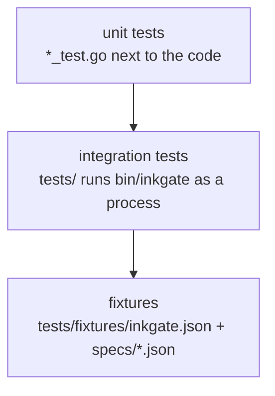

# Testing

```sh
make build                 # bin/inkgate
make test                  # build, build the test plugins, go test ./... (includes the integration suite in tests/)
make test-plugins          # only the test .so plugins (go test of the plugin loaders needs them)
make test-certs            # the cert.pem and key.pem the jose tests need
go test -race ./...        # the same under the race detector; it must stay clean
make lint LINT_BASE=origin/main  # lint what this branch changed since main
make bench-ratelimit       # rate limiter benchmarks
go test ./feature/auth/... # one domain
go test ./tests            # integration only (needs bin/inkgate)
```

All test support files live in the root `tests/` folder: `tests/fixtures/` (integration config and specs,
plus `audit/`, `jose/` and `koanf/` data used by unit tests) and `tests/plugins/` (sources of the plugins the
loader tests open; `make test-plugins` builds the `.so` files next to them, and git ignores those).
`tests/testutils/` holds helpers shared by several packages, and `tests/amqp/` runs the AMQP connector against a
real RabbitMQ started with testcontainers-go (it skips itself when no container runtime is reachable; with podman
run `systemctl --user start podman.socket` and set `TESTCONTAINERS_RYUK_DISABLED=true`).

## Layers of tests



- **Unit tests** test one package with stubs (`httptest.Server`, fake proxies). Router code is tested next to it,
  for example `feature/traffic/ratelimit/router`.
- **Integration tests** (`tests/integration.go`) start a mock backend on `:8081`, run `bin/inkgate` with
  `tests/fixtures/inkgate.json`, and replay each spec in `tests/fixtures/specs/` (request → expected status,
  headers and body).
  Flags: `-inkgate_bin_path`, `-inkgate_config_path`, `-inkgate_specs_path`, `-inkgate_backend_port`,
  `-inkgate_startup_wait`.

## Adding an integration case

1. Add an endpoint to `tests/fixtures/inkgate.json` (use the mock backend at `http://localhost:8081`).
2. Add `tests/fixtures/specs/<name>.json`:

```json
{
  "in":  { "method": "GET", "url": "http://localhost:8080/my-endpoint", "header": {} },
  "out": { "status_code": 200, "body": "{\"foo\":42}", "header": { "X-Inkgate-Completed": ["true"] } }
}
```

`body` is the exact expected response body as a string.

3. `make test`.

## Before opening a PR

There is no CI for now: run the checks locally.

```sh
make test                        # build, test plugins, certificate, go test ./... with the integration suite
go test -race -count=1 ./...     # must stay free of data races
make lint LINT_BASE=origin/main  # lint the lines this branch changed since main
make sec                         # gosec
make vuln                        # govulncheck: known CVEs in what the code calls
```

`make lint` alone checks only the uncommitted changes; `LINT_BASE` checks a whole branch. The repository still
carries about 1,100 older lint findings (mostly function complexity and comment style in carried-over code), which
`make lint LINT_ALL=1` lists; they are paid down in dedicated refactors.

The AMQP suite (`tests/amqp`) skips itself without a container runtime: start one (with podman,
`systemctl --user start podman.socket`) when a change touches the AMQP connector.

To test the way the Docker image is built (Go 1.27 and glibc 2.41 of Debian trixie, which the plugins depend on), run
the suite in the build stage's image:

```sh
docker run --rm -v "$PWD":/src:z -w /src golang:1.27-trixie make test   # :z for SELinux (Fedora)
```

Tests that depend on time or ports must not use fixed sleeps or fixed ports: ask the OS for a free port and wait until
it listens (see `engine/transport/http/server/server_test.go`), and never call a service on the internet (the `rss`
integration case used to fetch showrss.info; the test backend now serves its feeds). A test that is slow under
`-race` fails at random; the test of the removed usage reporter did, because of a proof of work of a million hashes
per report.

## Known failures

The suite is green, also under `-race`. What to know about it is in [../known-issues.md](../known-issues.md).
