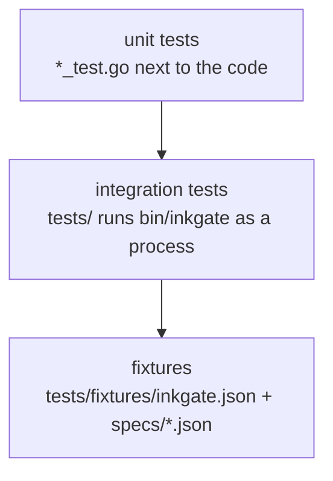

# Testing

```sh
make build                 # bin/inkgate
make test                  # build, build the test plugins, go test ./... (includes the integration suite in tests/)
make test-plugins          # only the test .so plugins (go test of the plugin loaders needs them)
make test-certs            # the cert.pem and key.pem the jose tests need
make bench-ratelimit       # rate limiter benchmarks
go test ./feature/auth/... # one domain
go test ./tests            # integration only (needs bin/inkgate)
```

All test support files live in the root `tests/` folder: `tests/fixtures/` (integration config and specs,
plus `audit/`, `jose/` and `koanf/` data used by unit tests) and `tests/plugins/` (sources of the plugins the
loader tests open; `make test-plugins` builds the `.so` files next to them, and git ignores those).
`tests/testutils/` holds helpers shared by several packages, and `tests/amqp/` runs the AMQP connector against a
real RabbitMQ started with testcontainers-go (it skips itself when no container runtime is reachable; with podman
run `systemctl --user start podman.socket` and set `TESTCONTAINERS_RYUK_DISABLED=true`).

## Layers of tests



- **Unit tests** test one package with stubs (`httptest.Server`, fake proxies). Router code is tested next to it,
  for example `feature/traffic/ratelimit/router`.
- **Integration tests** (`tests/integration.go`) start a mock backend on `:8081`, run `bin/inkgate` with
  `tests/fixtures/inkgate.json`, and replay each spec in `tests/fixtures/specs/` (request → expected status,
  headers and body).
  Flags: `-inkgate_bin_path`, `-inkgate_config_path`, `-inkgate_specs_path`, `-inkgate_backend_port`,
  `-inkgate_startup_wait`.

## Adding an integration case

1. Add an endpoint to `tests/fixtures/inkgate.json` (use the mock backend at `http://localhost:8081`).
2. Add `tests/fixtures/specs/<name>.json`:

```json
{
  "in":  { "method": "GET", "url": "http://localhost:8080/my-endpoint", "header": {} },
  "out": { "status_code": 200, "body": "{\"foo\":42}", "header": { "X-Inkgate-Completed": ["true"] } }
}
```

`body` is the exact expected response body as a string.

3. `make test`.

## Known failures

Some carried-over unit tests fail because of missing fixtures or unbuilt `.so` plugins. They are listed with their
causes in [../known-issues.md](../known-issues.md).
