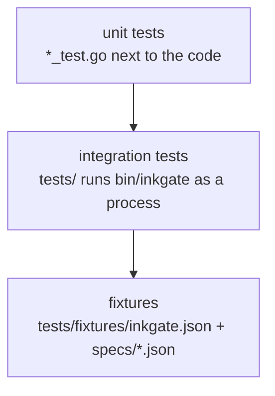

# Testing

```sh
make build                 # bin/inkgate
make test                  # build, go test ./... (includes the integration suite in tests/)
make check-layout          # gorilla/mux code only in the router, the adapters, flow/entry, flow/request and cmd
go test ./feature/auth/... # one domain
go test ./tests            # integration only (needs bin/inkgate)
```

## Layers of tests



- **Unit tests** test one package with stubs (`httptest.Server`, fake proxies). A mux adapter is tested next to it,
  for example `feature/traffic/ratelimit/mux`.
- **Integration tests** (`tests/integration.go`) start a mock backend on `:8081`, run `bin/inkgate` with
  `tests/fixtures/inkgate.json`, and replay each spec in `tests/fixtures/specs/` (request → expected status,
  headers and body). The same specs are used by every inkgate build, so behaviour stays identical across routers.
  Flags: `-inkgate_bin_path`, `-inkgate_config_path`, `-inkgate_specs_path`, `-inkgate_backend_port`,
  `-inkgate_startup_wait`.

## Adding an integration case

1. Add an endpoint to `tests/fixtures/inkgate.json` (use the mock backend at `http://localhost:8081`).
2. Add `tests/fixtures/specs/<name>.json`:

```json
{
  "in":  { "method": "GET", "url": "http://localhost:8080/my-endpoint", "header": {} },
  "out": { "status_code": 200, "body": "{\"foo\":42}", "header": { "X-Inkgate-Completed": ["true"] } }
}
```

`body` is the exact expected response body as a string.

3. `make test`.

## Known failures

Some carried-over unit tests fail because of missing fixtures or unbuilt `.so` plugins. They are listed with their
causes in [../known-issues.md](../known-issues.md).
