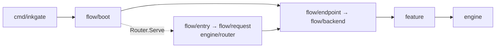

# inkgate architecture

inkgate has three kinds of folders. Read them in this order.

```
inkgate/
├── flow/               ① WHEN — the stages of a request, in order
│   ├── boot/               start the process: CLI, config, logging, telemetry, plugins, JWT revocation;
│   │                       builds endpoint + backend, then hands over to entry (boot.Router)
│   ├── entry/              traffic enters: listener (TLS, CORS, http-server plugins), gorilla/mux, service-wide middleware
│   ├── request/            per-endpoint HTTP handler: tracing, bot detector, metrics, JWT, Lua, rate limit
│   ├── endpoint/           endpoint pipeline: tracing, metrics, Lua, CEL, JSON schema, shadow, merge backends
│   └── backend/            one backend call: tracing, metrics, circuit breaker, rate limit, Lua, CEL,
│                           Lambda / AMQP / Pub/Sub, Martian, HTTP client (cache, OAuth2)
│
├── feature/            ② WHAT — one folder per business capability
│   ├── auth/           jose (JWT), bloomfilter (revocation), oauth2client
│   ├── security/       cors, httpsecure, botdetector
│   ├── validation/     cel, jsonschema
│   ├── traffic/        ratelimit, circuitbreaker, httpcache
│   ├── transform/      lua, martian, xml, rss
│   ├── connector/      amqp (+ async agents), pubsub, lambda
│   └── telemetry/      metrics, influx, opencensus, otel, gologging, gelf, logstash, usage, audit
│                       a feature that needs HTTP context keeps its router code next to its logic
│
├── engine/             ③ PLUMBING — generic machinery
│   ├── config/         model, parser (+ flexibleconfig, koanf)
│   ├── router/         router contract: Factory, RunServerFunc, Namespace
│   │   └── mux/            the gorilla/mux router
│   ├── proxy/          core pipeline: merge, flatmap, static, shadow, concurrent, filters, load balancing
│   ├── transport/http/ HTTP client (backend calls) and server (listener, TLS)
│   ├── encoding/  sd/  async/  plugin/  register/  backoff/  core/  logging/  cli/
│
├── context/            the flow context (*context.Flow) + the standard context API, imported instead of "context"
├── cmd/inkgate/         main: boot.Main(entry.Router)
├── internal/           helper libraries (binder, flatmap, lru, httpcache, auth0)
└── tests/              integration suite: runs bin/inkgate against fixtures
```

**Rule of thumb:** `flow` decides *when* something runs, `feature` decides *what* it does, `engine` is the
plumbing.



## The request, end to end

```
client
  │
  │   (every layer reads/extends the request's flow context: context.From(ctx) — see flow-context.md)
  ▼  entry ───────────────────────────────────────────────────────────────────
  │   HTTP(S) server → flow context → OpenTelemetry → CORS → http-server plugins
  │   secure headers → Lua (service) → bot detector → gorilla/mux router
  │                                                     │ 404 / 405 / redirects
  ▼  request  (one per endpoint) ─────────────────────────────────────────────
  │   1 OpenTelemetry   2 bot detector   3 OpenCensus   4 metrics
  │   5 JWT validation + revocation   6 Lua (endpoint)   7 rate limit
  │   8 endpoint handler: build proxy.Request, write response in output encoding
  ▼  endpoint ────────────────────────────────────────────────────────────────
  │   1 OpenTelemetry   2 OpenCensus   3 metrics   4 Lua (proxy)
  │   5 CEL rules   6 JSON schema   7 shadow backends
  │   8 engine/proxy: static data → modifier plugins → fan out to backends → merge → flatmap
  ▼  backend  (one per backend) ──────────────────────────────────────────────
  │   (engine/proxy already ran: query/header filter → URL build → concurrent calls → load balancer)
  │   1 OpenTelemetry   2 OpenCensus   3 metrics   4 circuit breaker   5 rate limit
  │   6 Lua (backend)   7 CEL   8 Lambda   9 AMQP   10 Pub/Sub
  │   11 Martian → HTTP client: client plugins → OpenCensus → OpenTelemetry → cache → OAuth2 → net/http
  ▼
backend service
```

In every stage file the steps are a slice written **in request order**, with the step number in a comment.

## Startup

`cmd/inkgate` → `boot.Main(entry.Router)` → CLI → `boot.Run`:

1. logging and (opt-in) usage reporter
2. DNS TTL, load Go `.so` plugins
3. shared services: metrics collector (`entry.Router.NewMetrics`), Influx, OpenCensus, OpenTelemetry, JWK cache, JWT revocation
4. build `backend.NewFactory` → `endpoint.NewFactory`
5. `entry.Serve(ctx, Services)` builds stages 2 and 3 and serves; async agents run beside it

Details: [startup.md](startup.md), [../flow/1-boot.md](../flow/1-boot.md).

## Common changes

| I want to... | Do this |
|---|---|
| add a step to requests | router code in `feature/<domain>/<name>` + one entry in `flow/request/request.go` |
| add a step to endpoints or backend calls | one entry in `flow/endpoint` or `flow/backend` |
| add a new capability | package under `feature/<domain>/`; add router code only if it needs HTTP context |
| add a new kind of backend (like Lambda) | `feature/connector/<name>`, then a step in `flow/backend` before Martian |
| add startup work | a function in `flow/boot/telemetry.go` (or a new file there) called from `Run` |
| change config parsing | `engine/config` |
| give a namespace a short alias | `aliases` in `flow/boot/main.go` |

## Naming

- `extra_config` namespaces are inkgate package paths (for example `inkgate/feature/traffic/httpcache`), the same in
  every inkgate build, and every namespace has a short alias (`qos/http-cache`). See
  [../guides/config-reference.md](../guides/config-reference.md). The Go module of this project is `inkgate`.
- Unknown namespaces are ignored without an error: a typo silently leaves the feature off.
- HTTP values: `X-Inkgate: Version <v>`, `X-Inkgate-Completed: true|false`, and `User-Agent: Inkgate Version <v>`
  towards backends.
