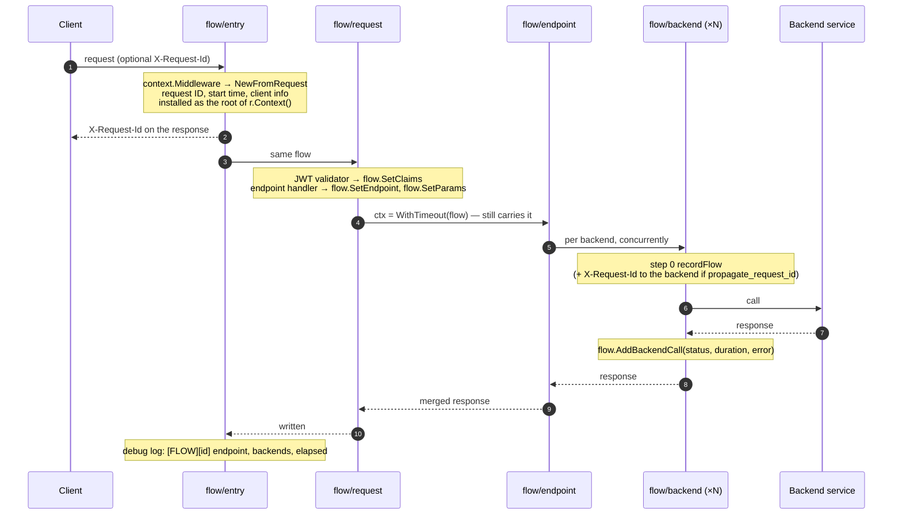

# Flow context

**Code:** [context](../../context) · **Type:** `*context.Flow` · **Get it:** `context.From(ctx)`

Every request gets one **flow context** when it enters the gateway. It carries the core data of that request through
every layer — entry, request, endpoint, backend — until the backend services have answered, and any layer can read
or add to it.

The project imports `github.com/9edang/inkgate/context` **instead of** the standard `"context"`. The package re-exports the whole
standard API (`context.Context` is a type alias of the standard interface, plus `Background`, `WithTimeout`,
`WithCancel`, ...), so signatures stay `ctx context.Context` and nothing needs an import alias.

```go
import "github.com/9edang/inkgate/context"

func (s step) call(ctx context.Context, req *proxy.Request) (*proxy.Response, error) {
	flow := context.From(ctx)          // the flow of this request (nil-safe)
	flow.RequestID()                   // "4b1c…" or the client's X-Request-Id
	flow.Claims()["sub"]               // JWT claims, once the validator ran
	flow.Set("tenant", "acme")         // visible to every later layer
	ctx, cancel := context.WithTimeout(ctx, time.Second) // still carries the flow
	defer cancel()
	...
}
```

## Lifecycle



Async agents create a flow too (`Kind = "async"`, `Source` = agent name) for every message they consume, so the
endpoint and backend stages see the same thing whether the work came from HTTP or a queue.

## What it carries

| Data | Set by | Read with |
|---|---|---|
| request ID | `flow/entry` (client header if valid and trusted, else a UUID) | `RequestID()` |
| kind / source | entry (`http`) or async agent (`async`, agent name) | `Kind()`, `Source()` |
| start time | entry | `StartedAt()`, `Elapsed()` |
| client: method, path, host, IP | entry | `Client()` |
| endpoint pattern + method | endpoint handler (`engine/router/mux/endpoint.go`) | `Endpoint()` |
| path params | endpoint handler | `Params()` (copy) |
| JWT claims | JWT validator (`feature/auth/jose/mux`) | `Claims()` (copy) |
| backend calls: url_pattern, method, hosts, status, complete, duration, error | `flow/backend` step 0 (`recordFlow`) | `BackendCalls()` (copy) |
| custom values | any layer | `Set`, `Get`, `Delete` |

All methods are safe for concurrent use (backend calls run in parallel) and safe on a nil `*Flow`, so code that runs
outside a request — unit tests, tools — doesn't need nil checks.

## Configuration

Service-level `extra_config`, namespace `inkgate/context` (alias `context`):

```json
"extra_config": {
  "context": {
    "request_id_header": "X-Request-Id",
    "trust_request_id": true,
    "propagate_request_id": false
  }
}
```

| Option | Default | Effect |
|---|---|---|
| `request_id_header` | `X-Request-Id` | header read from clients, written on responses, and sent to backends when propagating |
| `trust_request_id` | `true` | reuse the client's ID when it is printable ASCII without spaces, at most 128 characters; otherwise generate one |
| `propagate_request_id` | `false` | add the request ID header to every backend request |

## Plugins

All three kinds of Go `.so` plugins run inside the flow and receive a context that carries it:

| Plugin | Context it gets |
|---|---|
| http-server | `r.Context()` of each request (the flow context runs before plugins) |
| req/resp modifier | `Context()` of the request/response wrapper |
| http-client | `req.Context()` of the backend request |

A plugin **should not import `github.com/9edang/inkgate/context`**. Go only loads a plugin when every package it shares with the
gateway was compiled from identical source with the same toolchain; importing gateway packages ties the `.so` to
one exact gateway build ("plugin was built with a different version of package ..."), and `inkgate` is not a
fetchable module path. Instead, use the string key and a local interface:

```go
type flow interface {
	RequestID() string
	Claims() map[string]interface{}
	Get(key string) (interface{}, bool)
	Set(key string, value interface{})
}

func (r registerer) handler(next http.Handler) http.Handler {
	return http.HandlerFunc(func(w http.ResponseWriter, req *http.Request) {
		if f, ok := req.Context().Value("inkgate.flow").(flow); ok {
			f.Set("myplugin.seen", true)
			w.Header().Set("X-Seen-By", f.RequestID())
		}
		next.ServeHTTP(w, req)
	})
}
```

Only methods with standard types fit such an interface (`BackendCalls()` returns a gateway type, so it doesn't).

## Rules for layers

- Take `ctx context.Context` and call `context.From(ctx)`; never pass `*context.Flow` around instead of the context.
- Derive contexts as usual (`WithTimeout`, `WithCancel`, `WithValue`); the flow is found through any of them.
- Treat values from `Params()`, `Claims()` and `BackendCalls()` as copies; change the flow only through its methods.
- Use namespaced keys for `Set` (`"lua.score"`, `"tenant"`) to avoid collisions between features.
