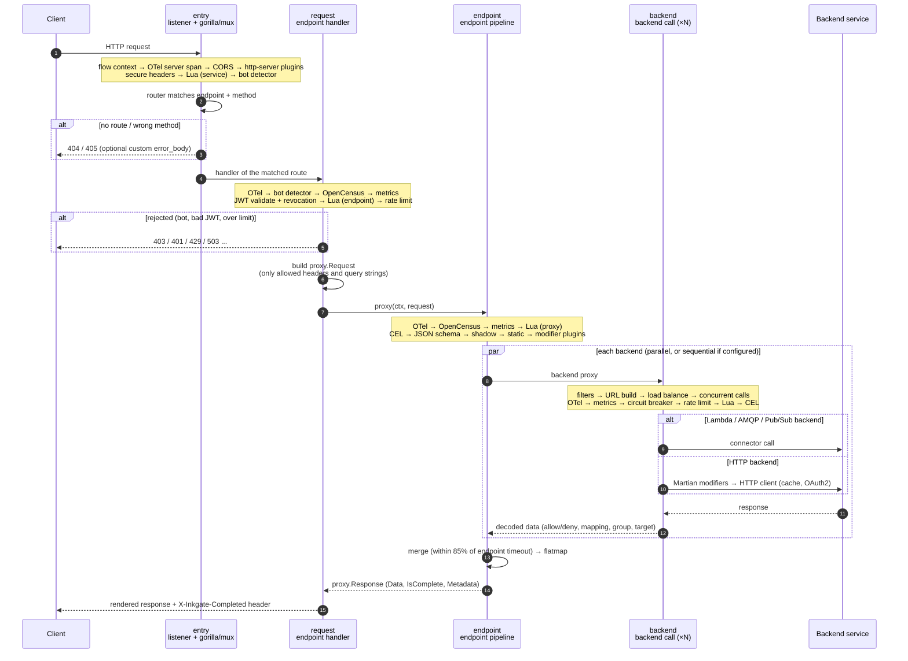

# Request lifecycle

What happens to one request, from the client to the backends and back. Each box names the stage folder in `flow/`
and the step number used in the code comments.

## Sequence

## The data on the way

| Point | Type | Defined in |
|---|---|---|
| entering stage 3 | `*http.Request` (+ `mux.Vars`) | net/http, gorilla/mux |
| between 3 and 4 | `*proxy.Request`: Method, URL, Query, Path, Body, Params, Headers | `engine/proxy/request.go` |
| out of 4 and 5 | `*proxy.Response`: Data (map), IsComplete, Metadata (headers, status), Io (raw body for `no-op`) | `engine/proxy/proxy.go` |
| a backend step | `proxy.Proxy` = `func(ctx, *Request) (*Response, error)` | `engine/proxy/proxy.go` |

## Completeness

`IsComplete` is true only when every backend answered without error before the timeout. The handler sends it as
the `X-Inkgate-Completed` header. A merge with failed backends still returns what it has: status 200 with partial
data, unless the endpoint uses `no-op` encoding, or a backend error is turned into the response by
`return_error_code` / `return_error_details` (see [../engine/transport.md](../engine/transport.md)).

## Where time goes

- `timeout` on the endpoint (default from the service `timeout`) bounds the whole pipeline.
- The merge step gives its backends **85%** of that timeout, so there is time left to render.
- Shadow backends have their own `shadow_timeout` and never delay the response.
