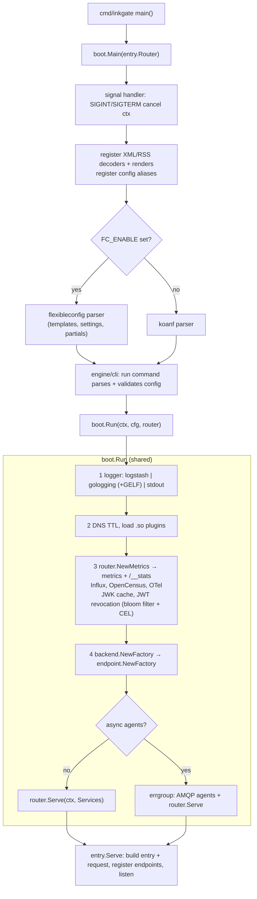

# Startup

From `inkgate run -c inkgate.json` to serving the first request.

## Step details

| # | What | Code | Notes |
|---|---|---|---|
| 0 | CLI + parse | `flow/boot/main.go`, `engine/cli`, `engine/config` | fails fast on invalid config; `check` stops here |
| 1 | logger | `flow/boot/logging.go` | first configured wins; the GELF writer is passed to entry for access logs |
| 2 | plugins | `flow/boot/plugins.go` | loads every `.so` matching `plugin.pattern` in `plugin.folder` |
| 3 | telemetry | `entry.Router.NewMetrics` + `flow/boot/telemetry.go` | entry creates the collector and its `/__stats` server; exporters do nothing without their namespace |
| 3b | token rejecter | `flow/boot/telemetry.go` `newTokenRejecter` | bloom filter (`auth/revoker`) + CEL rules that use `JWT` |
| 4 | shared stages | `flow/backend`, `flow/endpoint` | builders only; nothing runs yet |
| 5 | serve | `Serve` in `flow/entry/serve.go` | builds one pipeline per endpoint + method, then listens |

Pipelines are built **once at startup**, not per request. A config change needs a restart.

## Shutdown

Cancelling the context (SIGINT/SIGTERM) stops the listener gracefully (`max_shutdown_wait_time`), stops async
agents, and flushes OpenTelemetry (`closeTelemetry`).
